# Noxiouse Engine Documentation

Welcome to the official documentation for **Noxiouse Engine** — a modern **C++20 / Vulkan 1.4 & Direct3D 12 / .NET 10** 3D game engine and custom **NoxUI** editor built around a **bindless GPU-driven visibility-buffer renderer**, a **frame-compiled Render Graph**, **decoupled hardware Ray Tracing & ReSTIR**, **Large World Coordinates (64-bit `double`)**, **World Partition & HLOD streaming**, **Jolt 3D / Box2D v3 physics**, **Skeletal Animation Graphs & Sequencer**, and **C# Atomic Hot-Reload Scripting**.

:::{tip}
**Want to browse right now without installing Python or Sphinx?**
Open `docs-site/index.html` directly in any web browser! It includes the complete Godot-style Read the Docs interface, instant search across all **470+ engine files** and features, dark/light mode, and collapsible navigation.
:::

---

## High-Level Engine Architecture

Noxiouse is organized into four targets plus a sample game project:

| Target / Folder | Type | Plain-English Purpose |
| :--- | :--- | :--- |
| **`NoxCore/`** | Static Library (`C++20`) | The core engine: `NoxRHI` graphics abstraction (Vulkan 1.4 + Direct3D 12), frame-compiled `RenderGraph`, hybrid visibility-buffer + RT + path-traced `Renderer`, `Scene` ECS, `Asset` cooking & streaming pipeline, `Physics` (Jolt 3D v5.7 + Box2D v3.1), `Animation` & `NodeGraph`, `Scripting` (.NET 10 / Coral `320c90d`), `Tasks` (`NoxTasks`), `Audio` (`NoxAudio`), `Network` (`NoxNet`), and `Profiling`. |
| **`NoxScriptCore/`** | Managed Class Library (`C# / net10.0`) | The `Nox` C# API (`Nox.ScriptCore.dll`) providing `EntityBehaviour`, `Entity`, `[Expose]` (fields, properties, enums, events), component wrappers, `Physics`, `Mesh` / `MeshBuilder`, `Jobs`, `Scene`, `Input`, `WorldUnits`, and `Vector3d`. |
| **`NoxEditor/`** | Executable (`C++20` / `NoxUI`) | The custom `NoxUI`-powered authoring environment (zero Dear ImGui) with multi-viewport layout, gizmos, Undo/Redo, specialized panels (Hierarchy, Inspector with live Play-mode C# sync, Content Browser, Material Editor, Node Graph Editor, Animation Clip, Sequencer Timeline, Render Graph Inspector, Profiler, World Partition, Levels), and 1-click `.npak` Game Packager. Also houses all single-source **Slang shaders** in `NoxEditor/assets/shaders/`. |
| **`NoxRuntime/`** | Executable (`C++20`) | The lightweight shipping game player that mounts a cooked `.npak` archive, boots the startup scene in `RuntimeAssetManager` read-only mode, and runs the game loop without editor overhead. |
| **`Facerun/`** | Sample Project (`.nproj` + `C#`) | A playable testbed project showcasing character controllers, weapons/projectiles, multithreaded voxel terrain generation, additive level streaming, and World Partition streaming. |

---

## Six Golden Architectural Rules

1. **Zero Graphics API Leak**: Vulkan headers (`vulkan.hpp`, `vk_mem_alloc.h`, NVIDIA Streamline, NRD) live strictly inside `NoxCore/src/NRI/Vulkan/`. The rest of the engine talks exclusively to abstract `NRI::*` interfaces.
2. **100% Bindless (`VK_EXT_descriptor_heap`)**: No `VkDescriptorSet`s exist in engine rendering code. All textures, storage image mips, buffers, Acceleration Structures, and samplers live in a persistently mapped descriptor heap buffer indexed by `uint32_t` slot IDs, while buffers are accessed via 64-bit `BufferDeviceAddress` (BDA) pointers pushed via `vkCmdPushDataEXT`.
3. **Unified Image Layouts (`VK_KHR_unified_image_layouts`)**: Every GPU texture is transitioned to `VK_IMAGE_LAYOUT_GENERAL` once upon creation or upload and remains in `GENERAL` for its entire lifetime. Synchronization uses pure execution/memory stage+access masks (`VkMemoryBarrier2`).
4. **Reverse-Z Projection**: Near plane is mapped to `1.0` and far plane / infinity to `0.0`, paired with floating-point depth (`D32_SFLOAT`) and `CompareOp::Greater` or `GreaterOrEqual` for superior depth precision at kilometer distances.
5. **Large World Coordinates (LWC)**: Entity world translations (`TransformComponent::Translation`, `WorldTransformComponent::WorldPosition`) are stored in 64-bit `glm::dvec3` (`double`). Before uploading to the GPU, the renderer subtracts the camera's `glm::dvec3` world position on the CPU so every shader operates in high-precision **camera-relative `float` space**.
6. **Declarative Render Graph**: Every GPU pass is registered via `RenderGraph::AddPass(name, flags, setup, execute)`. The graph automatically culls unused passes, schedules Async Compute queues, aliases transient VRAM, synthesizes exact `Synchronization2` barriers, and records command buffers in parallel across worker threads.

---

## Complete Frame Lifecycle

```mermaid
flowchart TD
    A["SDL3 PollEvents & Window Resize Check"] --> B["Application::Run Frame Start"]
    B --> C["EditorLayer / RuntimeLayer::OnUpdate(ts)"]
    C --> D["AssetLoader::Update & TextureStreamer::Update (64 MB/frame budget)"]
    D --> E["Scene::OnUpdateRuntime / OnUpdateEditor"]
    E --> E1["1. TimelinePlayerComponent Evaluation"]
    E1 --> E2["2. C# OnUpdate & Fixed-Step 60Hz Loop (OnFixedUpdate + Box2D + Jolt 3D)"]
    E2 --> E3["3. Pose Interpolation + Parallel Animator / AnimationGraph Evaluation + Root Motion"]
    E3 --> E4["4. BoneSockets + C# OnLateUpdate + Parallel SceneGraph::UpdateWorldTransforms"]
    E4 --> E5["5. CPU ParticleSystem + Level Streaming + WorldPartition Cell Streaming"]
    E5 --> F["Scene::SyncGpuScene (Incremental EnTT Dirty Instance/Light Upload)"]
    F --> G["Renderer::drawFrame -> BuildFrameGraph"]
    G --> G1["Compute Skinning + BLAS/TLAS Builds + Geometry/VT Streaming Updates"]
    G1 --> G2["Phase 1 GPU Culling -> Meshlet Visibility Buffer -> Hi-Z Mip Build -> Phase 2 Late Culling & Visibility"]
    G2 --> G3["Fullscreen G-Buffer Resolve (Ray-Diff Barycentrics + Mip/VT Feedback)"]
    G3 --> G4["Decoupled RT / GI Passes (RT Shadows, RT Reflections, RTAO/SSAO, DDGI, Async Screen-Probe GI, ReSTIR DI/GI/PT, or Hardware Path Tracer)"]
    G4 --> G5["Deferred Lighting Composition + Skybox/Volumetric Clouds + Forward/OIT/Refraction + Particles"]
    G5 --> G6["DLSS Super Resolution / Ray Reconstruction or Custom TAA"]
    G6 --> G7["Auto-Exposure + Filmic Tonemapping + 2D Overlays + Selection Outlines + Extra Editor Views"]
    G7 --> H["RenderGraph::Compile() & Multi-Threaded Execute()"]
    H --> I["NoxUI / Swapchain Present & FrameArena::Reset()"]
```



---

## Documentation Contents

```{toctree}
:maxdepth: 2
:caption: Getting Started & Core

getting-started
core-tasks-profiling
```

```{toctree}
:maxdepth: 2
:caption: Graphics & Rendering

nri-vulkan
render-graph
renderer
shaders
```

```{toctree}
:maxdepth: 2
:caption: World, Assets & Gameplay

scene-ecs-world
assets-streaming
physics
animation-nodegraph
scripting
```

```{toctree}
:maxdepth: 2
:caption: Networking & Automation

networking
console-mcp
```

```{toctree}
:maxdepth: 2
:caption: Authoring & Tools

editor-runtime-sample
file-reference
```

---

## What's New (November 2026)

- **MagicaVoxel `.vox` models (Voxel plan VX0):** drop a `.vox` into the Content Browser (NoxEditor): the **Import Voxel Model** window (Voxel Size, Pivot, Merge Faces, Combine Models) cooks it into static meshes with greedy-merged faces, exact palette colours (three 256 x 1 palette textures) and MagicaVoxel's metal, glass and emissive materials; scenes with several models, rotations and mirrors are placed as in MagicaVoxel; saving in MagicaVoxel updates the editor. Re-importing a model through the dialog now cooks the same asset again with the new settings (glTF too). See the manual page *Voxel Models (MagicaVoxel .vox)* and Asset Pipeline section 3.
- **Stylized Rendering & Full Material Graph Complete (Steps 4e–6, R1, R2):**
  - **Vertex & Pixel Graph Stages (4e–4h):** Added `Object Position`, `Object Bounds` (Center/Extent/Radius), `Transform` (Local/World/View/Clip), `Matrix` (Model/View/Projection + inverses), `Vertex Interpolator` (up to 4 float4 Customized UV slots with screen derivatives), per-vertex `Vertex Normal` / `Vertex Color` overrides, all **18 PBR lobe output pins** (Clear Coat, Sheen, Specular, Iridescence, Anisotropy, Transmission, IOR, Thickness, Attenuation, Diffuse Transmission, Dispersion), and pixel-stage inputs `Pixel Normal` (post-Normal pin), `Scene Depth`, `Pixel Depth`, and `Depth Fade`.
  - **Subsurface Shading Model & `Subsurface Color` Pin (R1):** Added `MaterialShadingModel::Subsurface` (`.nmat` `NMA7`, `SubsurfaceShading.slang`: GGX specular + wrap diffuse terminator tint + backlit transmission scatter + soft ambient scatter) and Material Output Pin 31 (`Subsurface Color`).
  - **`AO Light Affect` & `Pixel Depth Offset` (R2):** Added `AO Light Affect` (Pin 32, G-buffer `emission.a`, darkens direct light by material AO) and `Pixel Depth Offset` (Pin 33, conservative Reverse-Z `SV_DepthLessEqual` in the visibility buffer and shadow maps with ray-plane barycentric recovery).
  - **Hand-Written `surface()` in Material Shaders (Step 5):** `.slang` Material Shaders can define `void surface(MaterialGraphInputs i, inout MaterialGraphOutputs o)` standalone on any shading model (via **Surface Graph / Shader**) or alongside `light()` / `ambient()` on Custom Lit, with live hot-reload.
  - **Rendering Style Project Setting & Audit (Step 6):** `Project Settings > Rendering > Rendering Style` (`Physical` / `Stylized`, saved in `.nproj`) with an async **Non-physical materials** audit list and live Material Editor advisory.
- **Direct3D 12 Backend Parity (`--dx12` / `--vk`):** full Direct3D 12 parity across `NoxEditor` and `NoxRuntime` via `NoxRHI` with DirectX 12 Agility SDK `1.620.2`, `D3D12MemoryAllocator v3.3.0`, async compute, parallel command recording, and single-source Slang shaders (`NoxGpu.slang`) alongside Vulkan 1.4.
- **Native `NoxUI` Editor (ImGui Removed):** promoted the custom `NoxUI` editor to `NoxEditor` and completely removed Dear ImGui, ImGuizmo, and `imgui-node-editor` from the engine.
- **.NET 10 & Coral `320c90d` Modern C# Scripting:** upgraded `NoxScriptCore` and game scripts to `net10.0` with **atomic hot-reload** (old scripts stay alive if a reload fails), **`[Expose]` C# `enum` dropdowns**, **`[Expose]` C# properties** (`get`/`set` validation, auto `ReadOnly`, and live Play-mode sync/editing in the Inspector), and **`[Expose]` C# `event` (`System.Action`) UnityEvent-style Inspector wiring** (see `Facerun/Assets/Scenes/CoralFeatureTest.nox`).
- **Updated Vendor Stack:** Slang `2026.22.1`, Streamline `2.14.16`, NRD `v4.18.0`, JoltPhysics `v5.7.0`, Box2D `v3.1`, VulkanMemoryAllocator-Hpp `v3.5.0+1`, tinygltf `v3.1.0`, Tracy `v0.15.0`, meshoptimizer `v1.3`, and taskflow `v4.1.0`.
- **Faster translucent shader:** the forward shader's secondary-ray code is no longer inlined several times over (4.7 MB -> 1.2 MB of SPIR-V for its main entry point): graph saves and the editor's first start compile it much faster (measured: start-up 35 s -> 13 s, a graph save 45 s -> 21 s); a graph's shaders compile in parallel and the graph shows on opaque surfaces after a few seconds while the rest finishes; the ray tracing passes' mask variants are built in the background and swapped in without stopping the editor, and only when the Opacity Mask itself changed; slow GPU driver compiles are logged.
- **Material graph Local Position, Vertex Tangent / Bitangent, stage tooltips:** dissolves and patterns that stay on an animated character (Local Position, before skinning), the mesh's tangent frame, and every Material Output pin and input says whether it runs per vertex, per pixel or per light.
- **Material graph lighting (Custom Light / Custom Ambient):** a Custom Lit material can be lit by its graph instead of a hand-written Material Shader -- the new Lit Surface, Light and Ambient Light nodes feed the Material Output's Custom Light and Custom Ambient pins (toon bands, rims, hatching from nodes).
- **Material graph World Position Offset in ray tracing:** a mesh moved by its graph's World Position Offset (a wave, wind) is moved for ray tracing too, every frame: ray-traced shadows, reflections, GI and the path tracer follow it.
- **Material graph surface at ray hits:** the path tracer, ray-traced reflections and the GI bounces (screen-probe GI, DDGI, ReSTIR GI / PT) now show a graph's Base Color, Metallic, Roughness, Normal, Emissive Color and Ambient Occlusion (a tint, a texture, a glow) instead of the material's own values; only the passes that shade their hits rebuild on a surface edit.
- **Material graph Opacity Mask in ray tracing:** ray-traced shadows, reflections, GI, AO and the path tracer now cut a graph's Opacity Mask (dissolves, leaves) like the view and the shadow maps; the ray tracing shaders recompile in the background only when a mask changes.
- **Per-object material graph parameters:** give one object its own value of a graph parameter -- one enemy dissolving, one lamp glowing -- in the Properties panel (Material > Parameters) or from C# (`MeshComponent.SetScalarParameter("Dissolve", t)`, `SetVectorParameter`, `SetTextureParameter`), Unreal's dynamic material instance; the material asset stays shared.
- **Material graph World Position Offset:** a graph can move its surface's vertices -- wind, waves, breathing -- in the view, the shadow maps, the motion vectors and the editor's outline and picking; a Max World Position Offset Displacement keeps the moving surface from being culled (ray-traced use comes with step 4c).
- **Faster shader builds:** saving a material graph or Material Shader builds on high-priority threads (the editor's rendering no longer starves them); the editor's first start always begins with the slowest shader, the forward shader most pipelines share; every compiled shader file logs its time.
- **Material graph Opacity Mask:** a graph's Opacity Mask cuts a Masked material away per pixel -- leaves, fences, dissolves -- in the view, the shadow maps and translucent drawing (ray-traced use comes with step 4c).
- **Material graph:** Unreal's material graph -- a `.nmatgraph` (Content Browser > + Add > Material Graph) with 45 nodes (textures, maths, parameters, Panner, Fresnel, Noise) into a Material Output; a material picks it in the Material Editor's Material Graph section and sets its parameters (one graph, many materials). Opaque and translucent surfaces, Opacity Mask and World Position Offset; ray-traced use comes later (see Material Authoring in the user manual and the Renderer page).
- **Custom Lit materials:** write a material's lighting yourself -- a Material Shader (Content Browser > + Add > Material Shader) is a small Slang file with `light()` per light and `ambient()`, like Godot's `light()`; materials use it with Shading Model > Custom Lit, four parameters and two textures. Shadows, GI, reflections, outlines and TAA / DLSS keep working; saving the file rebuilds it live (see Material Authoring in the user manual and the Renderer page).
- **Post Process Volume and outlines:** post effects and outlines saved with the scene (Unreal's Post Process Volume: unbound or a box, priority), and outlines -- silhouettes and creases drawn before TAA / DLSS, optionally on toon surfaces only (see the Renderer page).
- **Shading models:** each material picks **Default Lit**, **Unlit** or **Toon** (bands or a ramp texture, a sharp highlight, a rim light) in the Material Editor, whose labels now use Unreal's names (Blend Mode, Opacity Mask Clip Value, Two Sided); plan for outlines and a material graph in `docs/Stylized_Rendering_And_Material_Graph_Plan_2026-11.md` (see the Renderer page).
- **Multiplayer:** server-authoritative sessions, replication with RPCs, client prediction and interpolation, relevancy and bandwidth budgets, physics and animation replication, lag compensation, multiplayer Play in the editor and Package Server (see Networking).
- **Engine console and Output Log:** commands and variables with access levels, the Output Log tab with a Cmd line, the dedicated server's terminal, `--exec` (see Console, Output Log & MCP Server).
- **MCP server:** AI assistants (Claude Code and other MCP clients) read, edit (undoable) and play the open scene, take screenshots and drive the game with input, build scripts, edit materials and graphs, run tests and package; a running game has the same server for itself (NoxRuntime `--mcp`), and multiplayer Play can give every other player one, reached through the editor (`runtime_call`) (see Console, Output Log & MCP Server).
- **Raster versions of the ray-traced effects** -- cascaded shadow maps (cached), a local-light shadow atlas, contact shadows,
  GTAO, SSR + reflection probes, relightable irradiance probe volumes + SSGI, froxel volumetric fog -- and the **Raster (All)**
  preset (see the Renderer page).
- **Post effects:** bloom, depth of field, motion blur, color grading LUT, vignette / grain / chromatic aberration / lens flares, CAS.
- **More async compute:** NRD denoisers, DDGI blends and the emissive light grid on the compute queue.
- **Levels:** streamed levels drawn once complete, volumes that follow every streaming source, and **sub-levels** edited together
  in the **Levels** window, each saved into its own file (see Scene, ECS & World).
- **Profiler:** save / load captures, spike frames, a memory graph and a GPU Transfer track.
