# Noxiouse Engine Documentation

Welcome to the official documentation for **Noxiouse Engine** — a modern **C++20 / Vulkan 1.4 / .NET 9** 3D game engine and editor built around a **bindless GPU-driven visibility-buffer renderer**, a **frame-compiled Render Graph**, **decoupled hardware Ray Tracing & ReSTIR**, **Large World Coordinates (64-bit `double`)**, **World Partition & HLOD streaming**, **Jolt 3D / Box2D v3 physics**, **Skeletal Animation Graphs & Sequencer**, and **C# Hot-Reload Scripting**.

:::{tip}
**Want to browse right now without installing Python or Sphinx?**
Open `docs-site/index.html` directly in any web browser! It includes the complete Godot-style Read the Docs interface, instant search across all **470+ engine files** and features, dark/light mode, and collapsible navigation.
:::

---

## High-Level Engine Architecture

Noxiouse is organized into four targets plus a sample game project:

| Target / Folder | Type | Plain-English Purpose |
| :--- | :--- | :--- |
| **`NoxCore/`** | Static Library (`C++20`) | The core engine: `NRI` graphics abstraction, Vulkan 1.4 backend, frame-compiled `RenderGraph`, hybrid visibility-buffer + RT + path-traced `Renderer`, `Scene` ECS (47 components), `Asset` cooking & streaming pipeline, `Physics` (Jolt 3D + Box2D 2D), `Animation` & `NodeGraph`, `Scripting` (.NET 9 / Coral), `Tasks` (`JobSystem`), and `Profiling`. |
| **`NoxScriptCore/`** | Managed Class Library (`C# / net9.0`) | The `Nox` C# API (`Nox.ScriptCore.dll`) providing `EntityBehaviour`, `Entity`, component wrappers, `Physics`, `Mesh` / `MeshBuilder`, `Jobs`, `Scene`, `Input`, `WorldUnits`, and `Vector3d`. |
| **`NoxEditor/`** | Executable (`C++20`) | The full authoring environment with multi-viewport layout, gizmos, Undo/Redo, 12 specialized panels (Hierarchy/Inspector, Content Browser, Material Editor, Node Graph Editor, Animation Clip, Sequencer Timeline, Render Graph Inspector, Profiler, World Partition, Levels), and 1-click `.npak` Game Packager. Also houses all **113 Slang/HLSL shaders** in `NoxEditor/assets/shaders/`. |
| **`NoxRuntime/`** | Executable (`C++20`) | The lightweight shipping game player that mounts a cooked `.npak` archive, boots the startup scene in `RuntimeAssetManager` read-only mode, and runs the game loop without editor overhead. |
| **`Facerun/`** | Sample Project (`.nproj` + `C#`) | A playable testbed project showcasing character controllers, weapons/projectiles, multithreaded voxel terrain generation, additive level streaming, and World Partition streaming. |

---

## Six Golden Architectural Rules

1. **Zero Graphics API Leak**: Vulkan headers (`vulkan.hpp`, `vk_mem_alloc.h`, NVIDIA Streamline, NRD) live strictly inside `NoxCore/src/NRI/Vulkan/`. The rest of the engine talks exclusively to abstract `NRI::*` interfaces.
2. **100% Bindless (`VK_EXT_descriptor_heap`)**: No `VkDescriptorSet`s exist in engine rendering code. All textures, storage image mips, buffers, Acceleration Structures, and samplers live in a persistently mapped descriptor heap buffer indexed by `uint32_t` slot IDs, while buffers are accessed via 64-bit `BufferDeviceAddress` (BDA) pointers pushed via `vkCmdPushDataEXT`.
3. **Unified Image Layouts (`VK_KHR_unified_image_layouts`)**: Every GPU texture is transitioned to `VK_IMAGE_LAYOUT_GENERAL` once upon creation or upload and remains in `GENERAL` for its entire lifetime. Synchronization uses pure execution/memory stage+access masks (`VkMemoryBarrier2`).
4. **Reverse-Z Projection**: Near plane is mapped to `1.0` and far plane / infinity to `0.0`, paired with floating-point depth (`D32_SFLOAT`) and `CompareOp::Greater` or `GreaterOrEqual` for superior depth precision at kilometer distances.
5. **Large World Coordinates (LWC)**: Entity world translations (`TransformComponent::Translation`, `WorldTransformComponent::WorldPosition`) are stored in 64-bit `glm::dvec3` (`double`). Before uploading to the GPU, the renderer subtracts the camera's `glm::dvec3` world position on the CPU so every shader operates in high-precision **camera-relative `float` space**.
6. **Declarative Render Graph**: Every GPU pass is registered via `RenderGraph::AddPass(name, flags, setup, execute)`. The graph automatically culls unused passes, schedules Async Compute queues, aliases transient VRAM, synthesizes exact `Synchronization2` barriers, and records command buffers in parallel across worker threads.

---

## Complete Frame Lifecycle

```mermaid
flowchart TD
    A["SDL3 PollEvents & Window Resize Check"] --> B["Application::Run Frame Start"]
    B --> C["EditorLayer / RuntimeLayer::OnUpdate(ts)"]
    C --> D["AssetLoader::Update & TextureStreamer::Update (64 MB/frame budget)"]
    D --> E["Scene::OnUpdateRuntime / OnUpdateEditor"]
    E --> E1["1. TimelinePlayerComponent Evaluation"]
    E1 --> E2["2. C# OnUpdate & Fixed-Step 60Hz Loop (OnFixedUpdate + Box2D + Jolt 3D)"]
    E2 --> E3["3. Pose Interpolation + Parallel Animator / AnimationGraph Evaluation + Root Motion"]
    E3 --> E4["4. BoneSockets + C# OnLateUpdate + Parallel SceneGraph::UpdateWorldTransforms"]
    E4 --> E5["5. CPU ParticleSystem + Level Streaming + WorldPartition Cell Streaming"]
    E5 --> F["Scene::SyncGpuScene (Incremental EnTT Dirty Instance/Light Upload)"]
    F --> G["Renderer::drawFrame -> BuildFrameGraph"]
    G --> G1["Compute Skinning + BLAS/TLAS Builds + Geometry/VT Streaming Updates"]
    G1 --> G2["Phase 1 GPU Culling -> Meshlet Visibility Buffer -> Hi-Z Mip Build -> Phase 2 Late Culling & Visibility"]
    G2 --> G3["Fullscreen G-Buffer Resolve (Ray-Diff Barycentrics + Mip/VT Feedback)"]
    G3 --> G4["Decoupled RT / GI Passes (RT Shadows, RT Reflections, RTAO/SSAO, DDGI, Async Screen-Probe GI, ReSTIR DI/GI/PT, or Hardware Path Tracer)"]
    G4 --> G5["Deferred Lighting Composition + Skybox/Volumetric Clouds + Forward/OIT/Refraction + Particles"]
    G5 --> G6["DLSS Super Resolution / Ray Reconstruction or Custom TAA"]
    G6 --> G7["Auto-Exposure + Filmic Tonemapping + 2D Overlays + Selection Outlines + Extra Editor Views"]
    G7 --> H["RenderGraph::Compile() & Multi-Threaded Execute()"]
    H --> I["ImGui / Swapchain Present & FrameArena::Reset()"]
```



---

## Documentation Contents

```{toctree}
:maxdepth: 2
:caption: Getting Started & Core

getting-started
core-tasks-profiling
```

```{toctree}
:maxdepth: 2
:caption: Graphics & Rendering

nri-vulkan
render-graph
renderer
shaders
```

```{toctree}
:maxdepth: 2
:caption: World, Assets & Gameplay

scene-ecs-world
assets-streaming
physics
animation-nodegraph
scripting
```

```{toctree}
:maxdepth: 2
:caption: Networking & Automation

networking
console-mcp
```

```{toctree}
:maxdepth: 2
:caption: Authoring & Tools

editor-runtime-sample
file-reference
```

---

## What's New (November 2026)

- **Shading models:** each material picks **Default Lit**, **Unlit** or **Toon** (bands or a ramp texture, a sharp highlight, a rim light) in the Material Editor, whose labels now use Unreal's names (Blend Mode, Opacity Mask Clip Value, Two Sided); plan for outlines and a material graph in `docs/Stylized_Rendering_And_Material_Graph_Plan_2026-11.md` (see the Renderer page).
- **Multiplayer:** server-authoritative sessions, replication with RPCs, client prediction and interpolation, relevancy and bandwidth budgets, physics and animation replication, lag compensation, multiplayer Play in the editor and Package Server (see Networking).
- **Engine console and Output Log:** commands and variables with access levels, the Output Log tab with a Cmd line, the dedicated server's terminal, `--exec` (see Console, Output Log & MCP Server).
- **MCP server:** AI assistants (Claude Code and other MCP clients) read, edit (undoable) and play the open scene, take screenshots and drive the game with input, build scripts, edit materials and graphs, run tests and package; a running game has the same server for itself (NoxRuntime `--mcp`), and multiplayer Play can give every other player one, reached through the editor (`runtime_call`) (see Console, Output Log & MCP Server).
- **Raster versions of the ray-traced effects** -- cascaded shadow maps (cached), a local-light shadow atlas, contact shadows,
  GTAO, SSR + reflection probes, relightable irradiance probe volumes + SSGI, froxel volumetric fog -- and the **Raster (All)**
  preset (see the Renderer page).
- **Post effects:** bloom, depth of field, motion blur, color grading LUT, vignette / grain / chromatic aberration / lens flares, CAS.
- **More async compute:** NRD denoisers, DDGI blends and the emissive light grid on the compute queue.
- **Levels:** streamed levels drawn once complete, volumes that follow every streaming source, and **sub-levels** edited together
  in the **Levels** window, each saved into its own file (see Scene, ECS & World).
- **Profiler:** save / load captures, spike frames, a memory graph and a GPU Transfer track.
