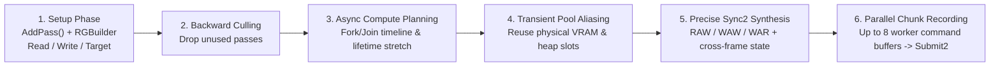

# Frame-Compiled Render Graph (`NoxCore/RenderGraph`)

Every single piece of GPU work in Noxiouse is declared as a pass in the **Frame-Compiled Render Graph** (`NoxCore/src/NoxCore/RenderGraph/`). No pass ever manually issues `vkCmdPipelineBarrier2`, allocates temporary render targets, or manages command buffers directly.

---

## 1. How the Render Graph Works (Plain & Simple)

Each frame, `Renderer::BuildFrameGraph` builds the graph from scratch in two phases:

1. **Setup Phase (Main Thread)**:
   - Passes call `graph.AddPass(name, flags, setupLambda, executeLambda)`.
   - Inside `setupLambda(RGBuilder&)`, a pass declares every texture and buffer it will **Read**, **Write**, or bind as a **ColorTarget** / **DepthTarget** / **SwapchainTarget**, plus optional **RecordExclusive** keys (e.g., `"NRD"`, `"Streamline"`, `"ImGui"`) for SDKs that aren't thread-safe.
   - Zero heap allocations occur: execute lambdas are placement-new'd directly into the current frame's `FrameArena`.
2. **Compile & Execute Phase (`RenderGraph::Compile()` + `Execute()`)**:
   - **Stage 1 — Backward Dead-Pass Culling**: Starts from passes that write to the swapchain, imported resources, or temporal history resources (or carry `RGPassFlags::NeverCull`) and walks backward. Any pass whose outputs aren't needed this frame is automatically culled!
   - **Stage 2 — Lifetime Calculation & Async Compute Scheduling (`PlanQueues`)**: Computes the exact `[FirstPass, LastPass]` lifetime of every resource. Groups contiguous `RGPassFlags::AsyncCompute` passes (such as Lumen-style Screen-Probe GI) onto the hardware `QueueType::Compute` queue, finds the graphics fork and join passes, inserts timeline semaphore waits/signals, and stretches transient lifetimes across the fork-join window so graphics passes cannot overwrite memory while async compute is using it.
   - **Stage 3 — First-Fit Transient Memory Aliasing (`RGResourcePool`)**: Assigns pooled physical GPU textures and buffers to transient handles. Once Pass B finishes reading a transient texture, Pass C later in the same frame can reuse the exact same physical VRAM allocation! Furthermore, bindless descriptor heap slots remain persistently registered on pooled textures across frames.
   - **Stage 4 — Live Texture Inspection & Validation**: Verifies every handle's frame stamp (`{Index, Frame}`) and schedules a pixel/preview copy right after `LastWriterPass` if the user clicked a texture in the editor's Render Graph Inspector (capturing it *before* a later pass aliases the physical texture).
   - **Stage 5 — Precise `Synchronization2` Barrier Synthesis (`PlanPreciseSynchronization`)**: Tracks per-physical-resource state (`lastWrite`, `readsSinceWrite`, per-queue visibility, and cross-frame `m_CarriedStates`) and emits the minimal set of `VkImageMemoryBarrier2` (always `eGeneral -> eGeneral`) and `VkBufferMemoryBarrier2` transitions before each pass.
   - **Stage 6 — Adaptive Multi-Threaded Command Recording**: Splits live passes into up to `8` load-balanced command buffer chunks using exponentially smoothed per-pass CPU recording times (`m_PassRecordMs`), respects `RecordExclusive` masks, records Vulkan command buffers in parallel across `JobSystem` worker threads, and submits them in order.

---

## 2. Render Graph Compilation Pipeline Diagram

---

## 3. File-by-File Reference: `NoxCore/src/NoxCore/RenderGraph/` (9 Files)

| File | Plain-English Summary & Key Types |
| :--- | :--- |
| [`RGTypes.h`](file:///E:/dev/noxiouse/NoxCore/src/NoxCore/RenderGraph/RGTypes.h) | Defines frame-stamped handles (`RGTexture`, `RGBuffer` with `{uint16_t Index, uint16_t Frame}`), `RGResourceKind` (`Imported`, `Transient`, `History`), `RGSize` (`RenderResolution`, `OutputResolution`, `Absolute` with scale factors), `RGTextureHistory` & `RGBufferHistory` (up to 4 ping-pong frames + `WasReset` flag), `RGTextureAccess`, `RGBufferAccess`, and `RGPassFlags` (`Raster`, `NeverCull`, `RayTracing`, `AsyncCompute`). |
| [`RGBlackboard.h`](file:///E:/dev/noxiouse/NoxCore/src/NoxCore/RenderGraph/RGBlackboard.h) | Type-safe per-frame dictionary (`Set<T>`, `Get<T>`, `TryGet<T>`, `Has<T>`) keyed by `entt::type_hash`. Allows decoupled pass modules (`RasterPasses.cpp`, `RTPasses.cpp`, `ReSTIRPasses.cpp`, `LightingPasses.cpp`, `PostPasses.cpp`) to share handles (`SceneState`, `VisibilityState`, `GBufferState`, `LightingState`, etc.) with zero heap allocations after frame 1. |
| [`RGResourcePool.h`](file:///E:/dev/noxiouse/NoxCore/src/NoxCore/RenderGraph/RGResourcePool.h) & [`RGResourcePool.cpp`](file:///E:/dev/noxiouse/NoxCore/src/NoxCore/RenderGraph/RGResourcePool.cpp) | Physical GPU resource pool for transient and history textures/buffers. Implements deterministic first-fit transient aliasing (`AcquireTransientTexture`, `AcquireTransientBuffer`), persistent bindless descriptor heap slot registration, named history persistence (`AcquireTextureHistory`, `AcquireBufferHistory`), a 120-frame idle keep window (`UnusedKeepFrames = 120`), and a 4-frame deferred release queue (`ReleaseDelayFrames = 4`). |
| [`RenderGraph.h`](file:///E:/dev/noxiouse/NoxCore/src/NoxCore/RenderGraph/RenderGraph.h) & [`RenderGraph.cpp`](file:///E:/dev/noxiouse/NoxCore/src/NoxCore/RenderGraph/RenderGraph.cpp) | Implements `RenderGraph`, `RGBuilder`, and `RGPassContext`. Handles `FrameArena` execute-callback allocation, backward pass culling, Async Compute fork/join scheduling, transient allocation, cross-frame + intra-frame `Synchronization2` barrier planning (`PlanPreciseSynchronization`), adaptive load-balanced parallel chunking (`PlanChunks`), and multi-queue submission. |
| [`RGValidation.cpp`](file:///E:/dev/noxiouse/NoxCore/src/NoxCore/RenderGraph/RGValidation.cpp) | Implements compile-time and runtime access validation (`ValidateHandle`, `ValidateContextAccess`, `ValidateCompiledFrame` — catching undeclared reads/writes or stale handles) plus live texture inspection (`InspectTexture`, `PlaceInspection`, `RecordInspection`) for the Render Graph editor panel. |
| [`RGFrameReport.h`](file:///E:/dev/noxiouse/NoxCore/src/NoxCore/RenderGraph/RGFrameReport.h) & [`RGFrameReport.cpp`](file:///E:/dev/noxiouse/NoxCore/src/NoxCore/RenderGraph/RGFrameReport.cpp) | Defines `RGFrameReport`, `RGPassReport`, and `RGResourceRow` (tracking pass timings, culled status, barrier counts, logical vs. aliased physical VRAM bytes, and per-pass read/write cells) and implements `WriteRenderGraphDot()` to export color-coded GraphViz `.dot` diagrams. |
