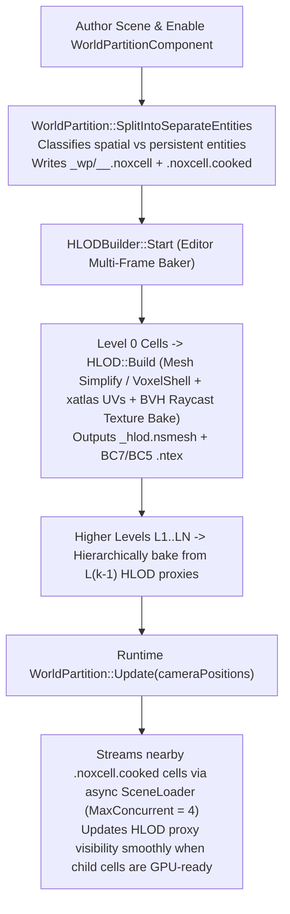

# ECS Scene, 47 Components, Prefabs, World Partition & HLOD (`NoxCore/Scene`)

Noxiouse's world representation lives in `NoxCore/src/NoxCore/Scene/` and is built on **EnTT** (`entt::registry`) with **64-bit Large World Coordinates (`glm::dvec3`)**, **parallel transform propagation**, **Prefabs & Prefab Variants**, **Incremental GPU Scene Synchronization**, **Unreal-style World Partition Spatial Streaming**, and **CPU BVH + UV-Atlas HLOD Baking**.

---

## 1. Complete Reference of All 47 ECS Components ([`Components.h`](file:///E:/dev/noxiouse/NoxCore/src/NoxCore/Scene/Components.h))

### Identity, Hierarchy & Metadata (6 Components)
1. **`IDComponent`**: Persistent 64-bit `UUID ID`.
2. **`TagComponent`**: Human-readable entity name (`std::string Tag`).
3. **`RelationshipComponent`**: Parent-child hierarchy links (`UUID Parent`, `std::vector<UUID> Children`).
4. **`MetadataComponent`**: Arbitrary string key-value dictionary (`std::unordered_map<std::string, std::string> Entries`), populated from glTF `node.extras` or authored in the Inspector / C# scripts.
5. **`PrefabInstanceComponent`**: Marks the root of a spawned `.nprefab` instance (`AssetHandle Prefab`, `std::vector<PrefabNodeOverride> Overrides`, `std::vector<UUID> RemovedNodes`).
6. **`PrefabNodeComponent`**: Attached to every entity inside a prefab instance (`UUID InstanceRoot`, `UUID PrefabNodeID`) so overrides map deterministically even after hierarchy edits.

### Large World Coordinate Transforms & Physics Pose Interpolation (3 Components)
7. **`TransformComponent`**: Local transform relative to parent:
   - `glm::dvec3 Translation` (**64-bit `double`** world units)
   - `glm::vec3 Rotation` (Euler XYZ radians, with cached quaternion `GetOrientation()`)
   - `glm::vec3 Scale`
   - `GetTransform()` returns a `glm::dmat4`.
8. **`WorldTransformComponent`**: Cached world-space matrix (`glm::dmat4 Transform`), previous-frame matrix (`PrevTransform` for object motion vectors), `uint32_t TransformRevision`, and `bool Dirty`.
9. **`PhysicsPoseComponent`**: Runtime-only component storing `PrevPosition`/`CurrPosition` (`glm::dvec3`) and `PrevRotation`/`CurrRotation` (`glm::quat`) from the last two 60 Hz physics steps so rendering at 120–800+ FPS smoothly interpolates (`glm::mix` / `glm::slerp`) physics motion without stutter!

### Meshes, Models, Materials, Decals & 3D Text (6 Components)
10. **`MeshComponent`**: Static or skeletal mesh binding (`AssetHandle Mesh`, `bool IsStatic`, `bool Visible`), plus three prioritized layers of morph target weights:
    - `AnimatedMorphWeights` (from `.nanim` curves)
    - `SequencerMorphWeights` (from `.ntimeline` tracks)
    - `MorphWeights` (from Inspector or C# `MeshComponent.SetMorphWeight`)
11. **`ModelComponent`**: Root component for a multi-node glTF model (`AssetHandle Model`, `Spawned`, `NodeOverrides`, `RemovedNodes`), expanded into child entities by `ModelInstance`.
12. **`ModelNodeComponent`**: Links a spawned child entity back to its `ModelRoot` and `NodeIndex`.
13. **`MaterialComponent`**: Per-submesh `AssetHandle` material overrides (`std::vector<AssetHandle> Materials`) plus runtime `SequencerParameters` (driven by `.ntimeline` tracks).
14. **`DecalComponent`**: Deferred/projected decal box (`AssetHandle AlbedoTexture`, `NormalTexture`, `Color`, `NormalBlend`, `FadeDistance`).
15. **`TextComponent`**: 3D world-space MSDF text (`TextString`, `AssetHandle FontAsset`, `Color`, `Kerning`, `LineSpacing`).

### Lighting, Sky Atmosphere, Volumetric Clouds & Camera (6 Components)
16. **`LightComponent`**: Unified analytic and area light (`LightType`: `Point`, `Spot`, `Directional`, `Rect`, `Disc`), `Color`, `Intensity`, `Range`, spot cone angles, area `Width`/`Height` (`TwoSided`), `CastShadows`, and `ShadowSoftness` (source radius / sun angular radius).
17. **`SkyLightComponent`**: Environment lighting (`AssetHandle EnvironmentMap`, `Intensity`, `Rotation`, `UseProceduralSky`) plus **Hillaire 2020 Physical Sky Atmosphere**, **Volumetric Clouds** (coverage, altitude, thickness, wind speed, silver lining), **Moon & Starfield**, and **Exponential Height Fog** settings.
18. **`DDGIVolumeComponent`**: Configures Cascaded Toroidal DDGI (`Enabled`, `CascadeCount` 1–4, `ProbeCounts`, `Cascade0Spacing`, `RaysPerProbe`, `Hysteresis`, `InfiniteBounceIntensity`, `RelocationEnabled`, `VisualizeProbes`).
19. **`PostProcessVolumeComponent`**: Configures bloom, vignette, chromatic aberration, color grading, and tonemapping overrides.
20. **`CameraComponent`**: `SceneCamera Camera`, `bool Primary`, `bool FixedAspectRatio`, and **Physical / Auto-Exposure** controls (`ExposureMode`: `AutoHistogram` or `ManualPhysical`, `EV100`, `ApertureFStop`, `ShutterSpeed`, `ISO`, `ExposureCompensation`, adaptation speeds).
21. **`SpriteRendererComponent`** & 22. **`CircleRendererComponent`**: 2D/3D sprite quad and procedural SDF circle renderers.

### Skeletal Animation, Sequencer & Particles (4 Components)
23. **`AnimatorComponent`**: Drives skeletal animation either from a single `AnimationSequence` or an `AnimationGraph` (`UseAnimationGraph = true`), with `Speed`, `Loop`, `EnableRootMotion`, runtime `AnimationGraphInstance`, and GPU skinning matrices (`BoneMatrices`, `PrevBoneMatrices`).
24. **`BoneSocketComponent`**: Attaches an entity to a specific bone (`BoneName`, `TargetEntity`, `PositionOffset`, `RotationOffset`) of a skeletal mesh.
25. **`TimelinePlayerComponent`**: Plays a `.ntimeline` Sequencer asset (`Timeline`, `Playing`, `Loop`, `Speed`, `CurrentTime`, `ActiveCameraEntity`).
26. **`ParticleEmitterComponent`**: CPU billboard particle emitter (rate, lifetime, velocity, Box/Sphere/Cone/Point shape, size/color curves, gravity, drag, spin, additive/alpha blend, flipbook rows/cols/FPS, texture).

### Scripting, 2D Physics & 3D Jolt Physics (13 Components)
27. **`ScriptComponent`**: Binds one or more C# `EntityBehaviour` classes (`ClassNames`, `FieldOverrides`, `EntityReferences`).
28. **`NativeScriptComponent`**: Binds a C++ `ScriptableEntity` subclass.
29. **`RigidBody2DComponent`**, 30. **`BoxCollider2DComponent`**, 31. **`CircleCollider2DComponent`**: Box2D v3 2D physics body and colliders.
32. **`RigidBody3DComponent`**: Jolt 3D rigid body (`Static`, `Kinematic`, `Dynamic`), mass, linear/angular damping, gravity factor, continuous collision detection (`CCD`), axis locks (`LockPositionX/Y/Z`, `LockRotationX/Y/Z`), and initial velocities.
33. **`BoxCollider3DComponent`**, 34. **`SphereCollider3DComponent`**, 35. **`CapsuleCollider3DComponent`**, 36. **`CylinderCollider3DComponent`**, 37. **`PlaneCollider3DComponent`**: Analytic 3D Jolt collision shapes (`Offset`, `Rotation`, dimensions, `Friction`, `Restitution`, `RollingFriction`, `IsTrigger`).
38. **`MeshCollider3DComponent`**: Cooks a Jolt `ConvexHullShape` or static `MeshShape` from `CollisionMesh` (or the entity's own `MeshComponent` / runtime `DynamicMesh`).
39. **`PhysicsJoint3DComponent`**: Connects two 3D rigid bodies via `Fixed`, `Point`, `Distance`, `Hinge`, `Slider`, `Cone`, or full `SixDOF` constraints with per-axis limits and spring/motor drives.
40. **`CollisionFilter3DComponent`**: 32-bit `LayerMask`, `CollideWithMask`, and `IgnoreEntities` list.
41. **`CharacterController3DComponent`**: Jolt `CharacterVirtual` capsule controller (`Radius`, `Height`, `MaxSlopeAngle`, `StepUpHeight`, `StickToFloorStepDown`, `GravityScale`, `Mass`).

### Level Streaming, World Partition & HLOD (5 Components)
42. **`LevelComponent`**: References a sub-level `.nox` scene asset (`SceneAsset`, `InitiallyLoaded`, `IsLoaded`, `Loading`).
43. **`LevelStreamingVolumeComponent`**: Axis-aligned trigger box (`HalfExtents`, `HysteresisMargin`) that automatically loads/unloads a target `LevelComponent` when the camera enters or exits.
44. **`WorldPartitionComponent`**: Enables automatic spatial grid streaming (`CellSize` default `64m`, `LoadingRange` default `192m`, `GridLevels` default `3`, `BlockOnSlowStreaming`).
45. **`WorldStreamingSourceComponent`**: Marks any entity (e.g., player pawn, remote camera, teleport destination) as an active streaming anchor with optional `RadiusOverride`.
46. **`HLODComponent`**: Marks a baked Hierarchical LOD proxy entity (`GridLevel`, `SourceCells`) so `WorldPartition` automatically hides it once all of its fine child cells finish streaming in.

---

## 2. World Partition & CPU HLOD Baking Pipeline

---

## 3. File-by-File Reference: `NoxCore/src/NoxCore/Scene/` (33 Files)

| File | Plain-English Summary & Key Responsibilities |
| :--- | :--- |
| [`Components.h`](file:///E:/dev/noxiouse/NoxCore/src/NoxCore/Scene/Components.h) | Defines all **47 ECS components** listed above. |
| [`Entity.h`](file:///E:/dev/noxiouse/NoxCore/src/NoxCore/Scene/Entity.h) & [`Entity.cpp`](file:///E:/dev/noxiouse/NoxCore/src/NoxCore/Scene/Entity.cpp) | Lightweight value wrapper around `(entt::entity, Scene*)` providing component CRUD, `SetParent` (preserving world transform and preventing cycles), `SetWorldTransform`, and `MarkTransformDirty`. |
| [`EntityBounds.h`](file:///E:/dev/noxiouse/NoxCore/src/NoxCore/Scene/EntityBounds.h) & [`EntityBounds.cpp`](file:///E:/dev/noxiouse/NoxCore/src/NoxCore/Scene/EntityBounds.cpp) | Computes double-precision world-space AABBs (`WorldBounds`, `ComputeWorldBounds`) across mesh submeshes, colliders, lights, and child hierarchies. |
| [`EntityCommandBuffer.h`](file:///E:/dev/noxiouse/NoxCore/src/NoxCore/Scene/EntityCommandBuffer.h) & [`EntityCommandBuffer.cpp`](file:///E:/dev/noxiouse/NoxCore/src/NoxCore/Scene/EntityCommandBuffer.cpp) | Lock-free deferred ECS command recorder backed by each worker thread's `FrameArena`, replayed deterministically at `Scene::ApplySyncPoint()`. |
| [`Scene.h`](file:///E:/dev/noxiouse/NoxCore/src/NoxCore/Scene/Scene.h) & [`Scene.cpp`](file:///E:/dev/noxiouse/NoxCore/src/NoxCore/Scene/Scene.cpp) | Central ECS world (`Scene : public Asset`). Orchestrates Runtime, Simulation, and Editor updates, fixed-step 60 Hz physics + pose interpolation, parallel animations, timelines, particles, level/world streaming, and incremental EnTT-driven GPU synchronization (`SyncGpuScene`). |
| [`SceneCamera.h`](file:///E:/dev/noxiouse/NoxCore/src/NoxCore/Scene/SceneCamera.h) & [`SceneCamera.cpp`](file:///E:/dev/noxiouse/NoxCore/src/NoxCore/Scene/SceneCamera.cpp) | Runtime camera implementing infinite Reverse-Z perspective (`near = 1.0`, `far = 0.0`) and Reverse-Z orthographic projections. |
| [`SceneGraph.h`](file:///E:/dev/noxiouse/NoxCore/src/NoxCore/Scene/SceneGraph.h) & [`SceneGraph.cpp`](file:///E:/dev/noxiouse/NoxCore/src/NoxCore/Scene/SceneGraph.cpp) | Parallel hierarchical transform solver (`UpdateWorldTransforms`). Expands a breadth-first frontier from dirty roots and propagates independent subtrees in parallel via `JobSystem::ParallelFor`. |
| [`ParticleSystem.h`](file:///E:/dev/noxiouse/NoxCore/src/NoxCore/Scene/ParticleSystem.h) & [`ParticleSystem.cpp`](file:///E:/dev/noxiouse/NoxCore/src/NoxCore/Scene/ParticleSystem.cpp) | Simulates up to 10,000 particles per `ParticleEmitterComponent` with LWC origin rebasing, emission shapes, drag, spin, flipbooks, and per-particle motion vectors. |
| [`ModelInstance.h`](file:///E:/dev/noxiouse/NoxCore/src/NoxCore/Scene/ModelInstance.h) & [`ModelInstance.cpp`](file:///E:/dev/noxiouse/NoxCore/src/NoxCore/Scene/ModelInstance.cpp) | Spawns entity hierarchies from imported `.nmesh`/`.nsmesh` glTF models, flattening simple static/single-skin hierarchies while translating glTF lights, cameras, instancing, extras, and physics into ECS components and preserving user overrides across reimports. |
| [`Prefab.h`](file:///E:/dev/noxiouse/NoxCore/src/NoxCore/Scene/Prefab.h), [`PrefabInstance.h`](file:///E:/dev/noxiouse/NoxCore/src/NoxCore/Scene/PrefabInstance.h) & [`PrefabInstance.cpp`](file:///E:/dev/noxiouse/NoxCore/src/NoxCore/Scene/PrefabInstance.cpp) | Implements `.nprefab` assets, **Prefab Variants** (`BasePrefab` inheritance), per-property YAML overrides, added/removed child structural overrides, live scene instance refreshing (`RefreshInstances`), `RevertOverride`, `ApplyOverride`, `Unpack`, and isolated Prefab Mode editing. |
| [`MaterialVariants.h`](file:///E:/dev/noxiouse/NoxCore/src/NoxCore/Scene/MaterialVariants.h) & [`MaterialVariants.cpp`](file:///E:/dev/noxiouse/NoxCore/src/NoxCore/Scene/MaterialVariants.cpp) | Runtime and editor switcher for glTF `KHR_materials_variants` (`List`, `Select`, `Current`). |
| [`SceneSerializer.h`](file:///E:/dev/noxiouse/NoxCore/src/NoxCore/Scene/SceneSerializer.h) & [`SceneSerializer.cpp`](file:///E:/dev/noxiouse/NoxCore/src/NoxCore/Scene/SceneSerializer.cpp) | Serializes and deserializes all 47 ECS components to/from human-readable YAML (`.nox`, `.nprefab`, `.noxcell`) and fast binary streams (`.noxbin`, `.noxcell.cooked` `NXCL`). |
| [`SceneLoader.h`](file:///E:/dev/noxiouse/NoxCore/src/NoxCore/Scene/SceneLoader.h) & [`SceneLoader.cpp`](file:///E:/dev/noxiouse/NoxCore/src/NoxCore/Scene/SceneLoader.cpp) | Non-blocking background scene/cell parser (`ParsedSceneData`) with main-thread time-sliced entity creation (`Step(budgetMs)`). |
| [`WorldPartition.h`](file:///E:/dev/noxiouse/NoxCore/src/NoxCore/Scene/WorldPartition.h) & [`WorldPartition.cpp`](file:///E:/dev/noxiouse/NoxCore/src/NoxCore/Scene/WorldPartition.cpp) | Automatic spatial grid partitioner (`SplitIntoSeparateEntities`, `MergeBackIntoScene`) and runtime cell streamer (`Update`, `UpdateHLODVisibility`). |
| [`HLODBake.h`](file:///E:/dev/noxiouse/NoxCore/src/NoxCore/Scene/HLODBake.h) & [`HLODBake.cpp`](file:///E:/dev/noxiouse/NoxCore/src/NoxCore/Scene/HLODBake.cpp) | CPU mesh simplifier (`meshoptimizer` or watertight dual-contouring `VoxelShell`), `xatlas` UV parameterization, and BVH ray-casting texture baker (baking BaseColor, Normal, MetallicRoughness, Emissive, Opacity, and Transmission maps). |
| [`HLODBuilder.h`](file:///E:/dev/noxiouse/NoxCore/src/NoxCore/Scene/HLODBuilder.h) & [`HLODBuilder.cpp`](file:///E:/dev/noxiouse/NoxCore/src/NoxCore/Scene/HLODBuilder.cpp) | Multi-frame background coordinator that decodes cell meshes/BC-compressed textures (`bcdec`), runs `HLOD::Build` across grid levels `L0..LN`, cooks `.nsmesh` + `.ntex` assets, and writes `HLODComponent` proxy entities into coarser cells. |
| [`ScriptableEntity.h`](file:///E:/dev/noxiouse/NoxCore/src/NoxCore/Scene/ScriptableEntity.h) | C++ native script base class (`OnCreate`, `OnDestroy`, `OnUpdate`). |
