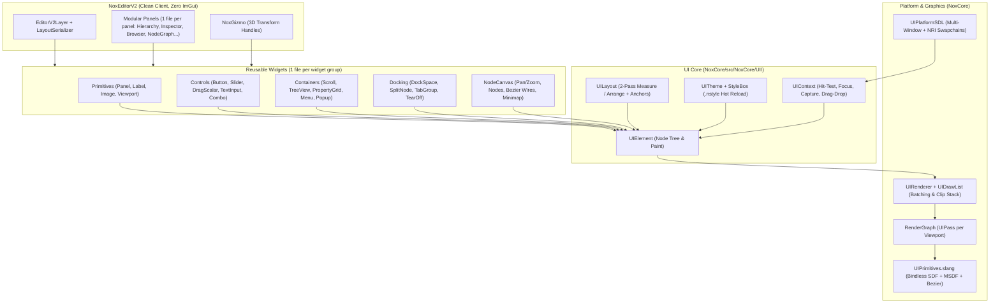

# Custom GUI System Architecture & Integration Plan

> **Target:** Replace Dear ImGui, `ImGuizmo`, and `thedmd/imgui-node-editor` in **Noxiouse** (`NoxCore` + `NoxEditor`), while optionally enabling runtime game UI in `NoxRuntime` / `NoxScriptCore`.  
> **Date:** November 2026  
> **Status:** Proposal / Pre-implementation

---

## 1. What Noxiouse Already Has (Audit from `docs-site` & `NoxCore`)

Before designing a GUI system from scratch, it is important to leverage what the engine already provides:

1. **Windowing & OS Integration (`SDL3`)**:
   - [`Window.cpp`](file:///E:/dev/noxiouse/NoxCore/src/NoxCore/Core/Window.cpp) already uses **SDL3** (`SDL_WINDOW_VULKAN | SDL_WINDOW_HIGH_PIXEL_DENSITY`), event polling, DPI awareness, relative mouse capture, and native file open/save dialogs ([`Utils.cpp`](file:///E:/dev/noxiouse/NoxCore/src/NoxCore/Utils/Utils.cpp)).
   - SDL3 natively supports **multiple `SDL_Window*` instances**, borderless windows with `SDL_HitTest` (for custom titlebars/docking), IME text input, and clipboard access.
2. **Graphics & Render Graph (`NRI` + `RenderGraph`)**:
   - Pure abstract `NRI` layer ([`NoxCore/src/NRI/`](file:///E:/dev/noxiouse/NoxCore/src/NRI/)): **100% bindless** via `VK_EXT_descriptor_heap` + 64-bit Buffer Device Address (BDA) push constants, `VK_KHR_unified_image_layouts` (all images stay in `GENERAL`), and Slang shaders compiled to SPIR-V 1.6 with live hot reload (`NOXWatcher`).
   - **Architectural win:** Today, `DeviceVK` has to maintain a legacy `VkDescriptorPool` *solely* for Dear ImGui's Vulkan backend. Replacing ImGui with an NRI-native GUI eliminates the last non-bindless descriptor pool in the engine (aside from the Streamline workaround).
3. **2D & Text Primitives (`Renderer2D` + `Font`)**:
   - [`Font`](file:///E:/dev/noxiouse/NoxCore/src/NoxCore/Renderer/Font.h) already generates and caches **MSDF (Multi-channel Signed Distance Field)** font atlases via `msdf-atlas-gen`. MSDF text stays razor-sharp at any scale — ideal for DPI scaling and zoomable node graphs.
   - [`Renderer2D`](file:///E:/dev/noxiouse/NoxCore/src/NoxCore/Renderer/Renderer2D.h) already has a screen-space mode (`BeginScreenSpace`/`EndScreenSpace`) used by `NoxRuntime`'s ImGui-free [`StatsOverlay`](file:///E:/dev/noxiouse/NoxCore/src/NoxCore/Profiling/StatsOverlay.cpp).
4. **Node Graph Decoupling (`INodeGraphCanvasBackend`)**:
   - [`INodeGraphCanvasBackend.h`](file:///E:/dev/noxiouse/NoxEditor/src/Panels/NodeGraph/INodeGraphCanvasBackend.h) already decouples `NodeGraphEditorPanel` (`.nanimgraph` and `.nmatgraph`) from `thedmd/imgui-node-editor`. Swapping the node-graph backend is already architected for!
5. **Existing UI Surface Area to Migrate**:
   - `ImGuiLayer` (`NoxCore/src/NoxCore/ImGui/`), `ImGuizmo` (3D viewport gizmos), `thedmd/imgui-node-editor`.
   - 11+ Editor Panels in `NoxEditor/src/Panels/`: `SceneHierarchyPanel` (hierarchy + 49-component Inspector), `ContentBrowserPanel`, `MaterialEditorPanel`, `NodeGraphEditorPanel`, `AnimationClipPanel`, `TimelinePanel`, `RenderGraphPanel`, `ProfilerPanel`, `WorldPartitionPanel`, `Levels`, `Output Log`, `StatsWindow`, plus multi-viewport (`ExtraViewPasses.cpp`, up to 7 secondary 3D views).

---

## 2. Retained Mode vs. Immediate Mode — What Big Engines Use

### How Major Engines Build Their UI

| Engine | Editor UI System | Runtime Game UI | Architecture | How Customization & Theming Work |
| :--- | :--- | :--- | :--- | :--- |
| **Unreal Engine 5 / 6** | **Slate** (pure C++) | **UMG** (wraps Slate) + CommonUI | **Retained** widget tree with declarative C++ (`SNew(SButton)...`) and `TAttribute<T>` reactive data binding | `FSlateStyleSet` / `FSlateBrush` (9-slice boxes, rounded boxes, fonts, colors) + two-pass layout (`ComputeDesiredSize` -> `ArrangeChildren`) |
| **Godot 4** | **Control** nodes (written in C++ using its own UI!) | **Control** nodes (same system) | **Retained** scene-tree nodes (`Container`, `HBoxContainer`, `GraphEdit`, `SplitContainer`) | Cascading **`Theme`** resource (`StyleBoxFlat` with corner radii, borders, shadows, margins, colors, fonts) inherited down the tree |
| **Unity (Modern)** | **UI Toolkit** (migrating off legacy IMGUI) | **UI Toolkit** (or uGUI Canvas) | **Retained** `VisualElement` tree + **Yoga** Flexbox layout + UXML/USS | **USS** (CSS subset: selectors, `:hover`/`:active`, transitions, variables, borders, radii) |
| **Dear ImGui** | (Third-party tool UI) | Not meant for game UI | **Immediate** (no persistent widget tree; rebuilt every frame) | `ImGuiStyle` global struct / `PushStyleColor`; hard to do complex layouts, animations, shadows, or CSS-like styling |

### Which Should Noxiouse Use?

**Recommendation: A Retained-Mode Core with Declarative C++ Ergonomics & Cascading Themes (Unreal Slate + Godot `Theme`/`StyleBox` hybrid).**

Why **Retained Mode** fits your requirements better than Immediate Mode:
1. **Easy, Deep Customization (Themes & Look)**:
   - In Immediate Mode, layout and drawing happen in the same call, making multi-pass styling (auto-sizing containers, right-aligned items, rounded borders, drop shadows, hover/press color animations, backdrop blur) awkward or 1-frame-laggy.
   - In Retained Mode, **Structure** (widget tree), **Style** (`StyleBox` / `UITheme` tokens), **Layout** (2-pass measure & arrange), and **Rendering** (batched GPU SDF primitives) are cleanly separated. Changing the entire look of the editor becomes editing a `.nstyle` (YAML/JSON) theme file with hot reload.
2. **Docking, Multi-Viewport, and Node Graphs**:
   - Docking splitters, tab groups, tear-off OS windows, virtualized lists (for 10,000+ scene entities), and zoomable node-graph canvases naturally have persistent state (scroll offsets, pan/zoom, tab order, splitter ratios, animation timers). Retained widgets own this state cleanly instead of stuffing it into string-hashed `ImGuiStorage` maps.
3. **Performance on Static Panels**:
   - Retained trees only re-run layout when marked dirty (`InvalidateLayout()`) and can cache/cull clipped children, whereas IMGUI re-evaluates every widget every frame.
4. **One System for Editor AND Game Runtime**:
   - Unlike Dear ImGui, a retained `UIElement` tree + `UITheme` can later be exposed to `NoxRuntime` and `NoxScriptCore` (C#) so games made in Noxiouse get a full, themeable UI system for free.

> **Keeping ImGui-like speed for quick tools:** You can build a lightweight **declarative/reactive helper** on top of the retained tree (similar to Slate's `SNew` / `TAttribute<T>` lambdas, or a `UIBuilder` that diffs/reconciles debug panels like `StatsWindow`) so writing a quick debug drawer is still only a few lines of C++.

---

## 3. Recommended Tech Stack (Minimal, Engine-Native)

| Responsibility | Choice | Why |
| :--- | :--- | :--- |
| **OS Windows, Input, DPI, Cursors, IME** | **SDL3** (already in `NoxCore`) | Zero new dependency. Supports multiple `SDL_Window*`, high-DPI scaling, `SDL_HitTest` for custom window chrome/docking, clipboard, file drops. |
| **Layout Engine** | **Custom 2-Pass Layout (`Measure` → `Arrange`)** (Slate + Godot style, no Yoga) | Zero external dependency (~800–1,200 LOC). Combines Unreal Slate's 2-pass `ComputeDesiredSize` / `ArrangeChildren` with Godot's **Anchors** (0..1 screen-relative pinning) and **Containers** (`HBox`, `VBox`, `Grid`, `Margin`, `Splitter`, `Overlay`, `Scroll`). |
| **Text Rendering** | **`msdf-atlas-gen` + `Nox::Font`** (already in `NoxCore`) | Already integrated! Crisp at any DPI and any zoom level in Node Graphs. *(Optional later: `HarfBuzz` for complex Unicode/ligatures, `LunaSVG` for vector icons.)* |
| **GPU UI Renderer** | **Custom NRI + Slang SDF Uber-Shader** | 100% bindless (`VK_EXT_descriptor_heap` + BDA). Single instanced/mesh-shader pass per viewport drawing SDF rounded rects, per-corner radii, borders, soft shadows, gradients, MSDF text, textures (e.g. 3D viewports!), and cubic Bezier curves. |
| **Theming & Styling** | **Cascading `UITheme` + `StyleBox` + State/Class Selectors (`.nstyle` YAML)** | Combines Godot's `StyleBoxFlat` (radii, borders, shadows, gradients) + Unreal's `FSlateStyleSet` tokens + CSS-style class/state selectors (`Button.primary:hover`) with smooth `dt` transitions & `NOXWatcher` live hot reload. |
| **Node Graph Canvas** | **Custom `NoxCanvas` implementing `INodeGraphCanvasBackend`** | Replaces `thedmd/imgui-node-editor`. Uses the same SDF renderer + MSDF text + spatial quadtree/AABB culling for smooth 60+ FPS pan/zoom. |
| **3D Viewport Gizmos** | **Custom `NoxGizmo` module** (replacing `ImGuizmo`) | Projects 3D axes/rings/planes using `EditorCamera` + draws via `Renderer2D` or `UIRenderer` with exact ray/segment hit-testing. |

---

## 4. Modular Architecture & File Breakdown (Separation of Concerns)

To avoid monolithic multi-thousand-line files, `Nox::UI` is split into **small, single-responsibility files** across four strict layers: **Rendering (GPU)** → **Core (Tree, Input, Theme, Layout)** → **Widgets (Controls, Containers, Docking, Graph)** → **NoxEditorV2 (Editor Panels)**.

### 4.1 Dependency & Data-Flow Graph

### 4.2 File-by-File Map (Small, Focused Files)

#### A. `NoxCore/src/NoxCore/UI/` (Shared by `NoxEditorV2` and `NoxRuntime`)
- **`Core/`**
  - `UITypes.h` — `UIRect`, `UIVec2`, `UIColor`, `CornerRadius`, `Thickness`, `Anchor` presets.
  - `UIElement.h/.cpp` — Base retained node: parent/children, `DirtyFlags` (`Layout`/`Paint`), `ComputeDesiredSize`, `ArrangeChildren`, `OnPaint`, `OnEvent`.
  - `UIContext.h/.cpp` — Per-window input router: hit-testing, hover/active/focus tracking, pointer capture, keyboard/IME, tooltips, drag-and-drop payloads.
  - `UITheme.h/.cpp` — `StyleBox` (fill, gradient, 4-corner radii, border, shadow, padding), class/state selectors (`:hover`, `:pressed`, `:disabled`), `dt` transitions, `.nstyle` YAML loader + `NOXWatcher` hot reload.
  - `UIBindings.h` — Lightweight `TAttribute<T>` / `Observable<T>` getter/setter helpers for reactive data binding.
- **`Layout/`**
  - `UILayout.h/.cpp` — `BoxLayout`, `StackLayout` (`HBox`/`VBox`), `GridLayout`, `AnchorLayout` (2-pass `Measure` → `Arrange` with `Fill`/`Expand` flags).
- **`Rendering/`**
  - `UIDrawList.h/.cpp` — High-level draw commands (`AddRoundedRect`, `AddText`, `AddImage`, `AddBezier`, `PushClipRect`/`PopClipRect`).
  - `UIRenderer.h/.cpp` — Converts `UIDrawList` into flat `UIPrimitive` & `UIClipRect` GPU buffers and records the `UIPass` in `RenderGraph`.
- **`Platform/`**
  - `UIPlatformSDL.h/.cpp` — Manages secondary `SDL_Window*`s + `NRI::Swapchain`s for multi-viewport tear-off windows, `SDL_HitTest` custom titlebars, and OS cursors.
- **`Widgets/`** *(each widget stays ~100–300 LOC)*
  - `UIPanel.h/.cpp`, `UILabel.h/.cpp`, `UIImage.h/.cpp` (supports Render Graph 3D viewport textures)
  - `UIButton.h/.cpp`, `UICheckBox.h/.cpp`, `UISlider.h/.cpp`, `UIDragScalar.h/.cpp`
  - `UITextInput.h/.cpp`, `UIComboBox.h/.cpp`, `UIColorPicker.h/.cpp`
  - `UIScrollView.h/.cpp`, `UITreeView.h/.cpp` (virtualized rows for 10k+ entities), `UIPropertyGrid.h/.cpp`
  - `UIMenuBar.h/.cpp`, `UIPopup.h/.cpp`
  - `UIDockSpace.h/.cpp` (binary `SplitNode` + `TabGroup` + drag-to-dock overlay + tear-off to `UIPlatformSDL`)
  - `UINodeCanvas.h/.cpp` (pan/zoom grid, SDF nodes, Bezier wires, minimap, box selection)
  - `UICurveEditor.h/.cpp` (for `TimelinePanel` / `ProfilerPanel`)

#### B. `NoxEditor/assets/shaders/UI/`
- `UIPrimitives.slang` — Bindless SDF uber-shader (`RoundedRect`, `MsdfGlyph`, `TexturedQuad`, `CubicBezier`, GPU `clipRectIndex`).

#### C. `NoxEditorV2/src/` (Clean Second Editor Executable — Renamed to `NoxEditor` at Parity)
- `Main.cpp`, `EditorV2Layer.h/.cpp` — Entry point, `DockSpace` setup, layout persistence, and menu bar.
- `Viewport/NoxGizmo.h/.cpp` — Custom 3D transform gizmos (replacing `ImGuizmo`).
- `Panels/` — One file pair per panel (`SceneHierarchyPanel`, `InspectorPanel`, `ContentBrowserPanel`, `MaterialEditorPanel`, `NoxCanvasBackend` implementing `INodeGraphCanvasBackend`, `TimelinePanel`, `RenderGraphPanel`, `ProfilerPanel`, `WorldPartitionPanel`, `LevelsPanel`, `OutputLogPanel`).

### 4.2 The GPU-Driven SDF UI Shader (`UIPrimitives.slang`)

Instead of tessellating rounded corners and shadows into thousands of CPU triangles like Dear ImGui, each UI primitive is a single **64–96 byte `UIPrimitive` struct** in a per-frame BDA storage buffer, rendered as a single instanced/mesh-shader pass:

- **Primitive Types**:
  1. `RoundedRect`: Center, half-size, 4-corner radii, fill color/gradient, border thickness & color, soft drop-shadow radius/offset/color. Evaluated analytically per pixel with `fwidth` anti-aliasing.
  2. `MsdfGlyph`: Quad bounds, atlas UV, bindless `fontAtlasSlot`, foreground color, optional outline.
  3. `TexturedQuad`: Quad bounds, UV rect, bindless `textureSlot` (used for icons, thumbnails, and **embedding 3D Render Graph viewport textures directly in panels**), tint, corner radius clipping.
  4. `CubicBezier`: 4 control points, thickness, color, optional dashed/animated flow (for node-graph wires and timeline curves).
- **Clipping**: Each primitive stores a `clipRectIndex` pointing into a small array of scissor/clip rects in the same frame buffer — **no draw-call splitting required for nested scroll views!**
- **Optional Glassmorphism**: Because `UIPass` runs inside `RenderGraph`, a panel flagged `BackdropBlur` can sample a downsampled blur of the underlying scene/UI texture.

### 4.3 Multi-Viewport & Docking Integration

1. **DockTree**: Binary tree of `SplitNode` (horizontal/vertical with draggable splitter ratio) and `LeafTabGroup` (list of docked `Panel`s + active tab index). Serialized to `EditorLayout.yaml`.
2. **Multi-Viewport (Floating OS Windows)**:
   - Dragging a tab out of a `LeafTabGroup` spawns a borderless `SDL_Window*` + `NRI::Swapchain` managed by `UIPlatformSDL`.
   - Each OS window has its own `UIViewport` root and records a lightweight `UIPass` in `RenderGraph` (or a dedicated swapchain present pass) so floating panels, detached 3D viewports, and menus render natively across multiple monitors.
   - `SDL_HitTest` lets custom-styled titlebars behave like native OS windows (Aero Snap, drag-to-maximize, resize edges).
   - **Built (2026-11-16 fix):** each floating window (`UIViewport`) uploads its UI into its own `UI::UIUploadBuffers` (one primitive + clip
     buffer pair per frame slot, 32768 primitives / 2048 clip rects), written from the start after its swapchain's `acquireNextImage` waited
     for the slot's previous submission. Before, floating windows wrote into the main window's per-frame buffers, which the main frame only
     guards with its own fences: the next main frame could overwrite primitives a floating window's GPU work was still reading (flicker or
     garbage in a floating panel). Checked by compiling only; not yet tested on the GPU.
   - **Validation note:** with Vulkan Configurator's synchronization validation on, `SYNC-HAZARD-WRITE-AFTER-PRESENT` at `vkQueuePresentKHR`
     appears once a scene's meshes stream in. It is a validation-layer limitation, not an engine or UI bug: the frame waits on the sparse
     geometry timeline, which only `vkQueueBindSparse` signals, and syncval does not track sparse binding ("No dedicated support for sparse
     resources" in its docs, still true in the 2026-11-16 sources). Confirmed by the user: the message disappears with sparse buffers off.

---

## 5. Phased Implementation Roadmap

### Phase 0: NRI Bindless UI Renderer & Render Graph Pass
- Define `UIPrimitive`, `UIClipRect`, and `UIPushConstants` in `shaderIO.h`.
- Write `UIPrimitives.slang` (SDF rounded rect + border + shadow, MSDF text, textured quad, cubic Bezier).
- Implement `UIRenderer` + `UIDrawList` and register `UIPass` in `RenderGraph` (`Renderer.cpp` / `Passes/EditorPasses.cpp`).
- **Verify:** Draw a styled test overlay with rounded panels, shadows, and MSDF text on top of the main viewport.

### Phase 1: Retained Widget Core, Layout, Input & Theming
- Implement `UIElement` tree, `UIContext` (pointer hit-testing, hover/active/focus states, keyboard/IME routing, drag-and-drop, cursor shapes), and 2-pass layout (or Yoga integration).
- Implement `UITheme` & `StyleBox` with YAML serialization and `NOXWatcher` hot reload.
- **Verify:** Live-edit a `.nstyle` theme file and watch panel colors, radii, borders, and fonts update immediately.

### Phase 2: Essential Editor Controls & Data Binding
- Build core widgets: `Label`, `Button`, `CheckBox`, `Slider`, `DragScalar` (scrubbable numbers like Blender/Unreal), `TextInput` (selection, undo, copy/paste), `ComboBox`, `ColorPicker`, `ScrollView`, `CollapsibleSection`.
- Build virtualized `TreeView` (only instantiates/lays out visible rows — essential for 10,000+ entity scenes) and `PropertyGrid` with `TAttribute`-style getter/setter bindings.
- **Verify:** Port a simple panel (e.g. `StatsWindow` or `Levels`) to `Nox::UI`.

#### Inspector widgets pass (2026-11-16, after the first test of InspectorV2)

What the user hit in the Inspector's material rows, and what each one was in the code:

| Seen | Cause | Now |
|---|---|---|
| Scroll bar hard to grab, no highlight | Each scrolling widget drew its own 5 px thumb; a press was only the bar's when no child lay under it, and the pointer capture stayed with that child, so the drag never followed | `UI::UIScrollBar` (one implementation for `UIScrollView`, `UITreeView`, `UILogView`, `UITableView`): a 12 px lane that takes the pointer before the content, thumb grabbed where it is pressed, wider and brighter under the pointer, accent colour while dragged, lit for a moment after the wheel. Painted after the children (`UIElement::OnPaintOverlay`), children clipped beside it (`GetChildClipRect`) |
| A long `.nmat` name drawn over the scroll bar | Layout was right, painting was not: text was drawn in full whatever its bounds | `UILabel::Elide` (default `End`, `Middle` for asset names; `UILabel::ElideText`): a line that does not fit ends in "...". `UIButton::TextElide`; a shortened button shows its full text as the tooltip. Card headers shorten their title |
| Colour: small hex text, no picker on click | `UIColorEdit` was given the context of the moment the panel was built -- none, the Inspector builds outside of events -- and returned when it was null (dropdowns had the same bug) | Popups open in the context of the click (`UIContext::GetCurrent()`). `UIColorEdit`: swatch + R / G / B (/ A) number fields 0-255 (they leave when the row is narrow); a click on the swatch opens the picker (`UI::UIPopup`, kept inside the window): saturation / value square, hue and alpha bars, new colour beside the old one (click it to go back), RGB, HSV and hex fields |
| Metallic / Roughness: a slider, no way to type | `UISlider`'s text edit hid behind a double click, and its first click moved the value | `UIDragScalar` is the one number field: drag = scrub (relative, Shift ten times finer), click = type (Enter / Tab / click elsewhere apply, Escape cancels, "," read as "."). `ShowFill` + a range makes it the slider (Unreal's numeric entry box). `InspectorCardBuilder::AddSlider` uses it |
| "Quick Edit" as a second button and a nested card | -- | One row per slot: chevron (the material's properties in place, as Godot and Unity open a resource), name (pick), **Edit** (the Material Editor panel, as Unreal opens the asset), three dots (Make Unique, Reset) |

Found on the way and fixed: `InspectorCardBuilder`'s editors captured `this` -- the builder, a local of the function filling the card -- and
called `OnMutate` through it after it was gone (they keep a copy now); `PopulateMaterialPropertiesUI` kept a reference to its callbacks
argument, a temporary; `UIButton` measured with the style's padding but arranged with style + own padding (own padding now replaces the
style's, and gives way before a fixed-size button's text is cut); a field of a closed popup or a rebuilt panel could still receive keys
(`UIContext::SetOverlay` / `DropDetachedInput`, `UIElement::OnFocusChanged`).

Then (user test: "clicking the arrow flashes the whole inspector"): `UIContext::UpdateAndRender` laid elements out before resolving
their styles, so an element made or shown this frame (a rebuilt panel, an opened section) was measured with the default style (padding 8
instead of the theme's) and drawn up to 60 px off for one frame. Styles are now resolved first, then layout, then the hover is updated at
the resting pointer (new content under it is hovered at once), then paint. The slot arrow no longer rebuilds the Inspector: its section is
built the first time it opens and only shown / hidden after that.

Checked: clang syntax check of every UI and NoxEditorV2 source; a headless test of the real widget code with fake input (68 checks, rebuild and open-section layout included: lane hit
test and capture, thumb grab without a jump, elision inside the lane, scrub / type / clamp / Escape, picker opens from a context-less editor
and stays in the window, hex parsing, input dropped for a rebuilt panel) and pictures of its draw lists. **Not run on a GPU**; the test is
not in the repository yet (it needs a stand-in for the font and the draw list). **Not yet:** a popup cannot leave its OS window (a picker
opened in a small floating panel window is squeezed into it); `UISlider` itself is unchanged (animation time, players).

#### Content Browser, thumbnails, Output Log, status bar and toasts (2026-11-16)

The user asked for the old Content Browser and its thumbnails back, redesigned: Unreal-style tiles, no prototype controls, rendered
pictures, the log as a tab beside it, a working Reset Layout, readable transform fields, and the notification system in the status bar.

Flaws of what was there before (NoxEditor's ImGui browser and the state of NoxEditorV2):

| Flaw | Now |
|---|---|
| Old browser: file-icon image buttons, names cut by a clip rect, no type label or colour, a toolbar with prototype controls (Tools, a tile-size slider, an up arrow), no Material creation, a modal for everything | `Panels/ContentBrowserV2Panel` (new): tiles like Unreal's -- a card with a shadow, the picture on top, a 3 px line in the type's colour, the name on up to two lines ending in "...", the type at the bottom right, small and muted. Folder tree on the left, toolbar `+ Add`, `Import`, `<` `>`, breadcrumb, search, type filter, `View` (Small / Medium / Large Tiles, Refresh, Show in Explorer). Footer: item count and selection |
| V2 had no Content Browser and no thumbnails | `Panels/AssetPreviewRenderer` (from NoxEditor) renders meshes, prefabs and material spheres with the thumbnail view and keeps them in `<Project>/Cache/Thumbnails`; textures show the texture itself in its proportions; everything else shows a vector icon of its type (cube, figure, sphere, picture, globe, node graph, bone, play, film strip, "Aa", speaker, `</>`). Saving a material in the Inspector redraws its sphere |
| V2 had no Output Log | `Panels/OutputLogV2Panel` (new): filter chips Errors / Warnings / Messages / Verbose with counts, search (every word), Copy, Clear, line selection (click, Shift, Ctrl, Ctrl+A, Ctrl+C, right-click menu), follows new lines at the bottom, the Cmd line (Tab completes -- `UIElement::CapturesTab` keeps Tab in the field --, Up / Down history, matching names listed above it). The ` key opens it |
| Reset Layout did not work | It rebuilt the UI inside the menu's own click (`SetRoot` while the event was being dispatched), left torn-off OS windows open and the old file in place, and the layout was saved into the engine's `assets/layouts` (in git). Now Reset runs at the start of the next frame: closes the OS windows (`UIViewportManager::Shutdown`), deletes the saved files, builds the default layout and saves it. Layout files live in `<Project>/Saved/Layout` (per project, like Unreal's `Saved/Config`); the three files in `NoxEditor/assets/layouts` are removed |
| Transform fields: the last digit hidden | Rows gave the label 39 % and the fields had lettered tags at font 18. `InspectorPropertyRow`: label `clamp(0.34 w, 76, 150)` px, the value the rest; axis fields with a coloured stripe instead of a letter, font 15, three decimals with trailing zeros dropped (`TrimZeros`), and a number too wide for its field drops decimals until it fits (123.456 -> 123.46 -> 123.5 -> 123; typing shows every digit) |
| Status bar was one label; toasts were plain text | Status bar: left a dot (green Ready / amber pulsing busy) and what runs (import progress, script build, scene opening, assets loading, textures streaming, MB to upload, BLAS builds); right the log's warnings and errors (click: the Output Log). `UIContext::PushNotification` (`UINotification`: Info / Success / Warning / Error, title, message): 340 px cards at the bottom right above the status bar, severity icon and stripe, slide and fade, a hovered toast waits, a click dismisses |

Toasts come from: scene saved / not saved, scene opened / not readable, project opened / not opened, layout saved / reset, script build
result (time, warnings, errors), model import started / finished, prefab created, assets moved / deleted / renamed (failures), files
imported, an asset with no V2 editor yet. Running work stays in the status bar (it is not a toast).

Also built: drag tiles into the viewport (meshes and prefabs placed on the surface under the pointer, else the ground plane; a scene
opens), onto a folder tile (moves them), entities from the hierarchy onto the tiles (a prefab in that folder; also the hierarchy's
Create Prefab), files dropped from the system (imported into the open folder; a model opens the import dialog first: static / skeletal
meshes, combine modes, animations, scale, file name), inline rename (F2), Duplicate, Delete with the users listed (files and the open
scene), Find References, Reimport, Copy Path, Show in Explorer, + Add: folder, Material, Material Graph, Material Shader, Animation Graph,
Audio Graph, Timeline, C# Script. Double-click: folder, scene, material (others: a toast that V2 has no editor for them yet). Keys typed
in the browser or the log no longer reach the editor's shortcuts (Delete deleted the selected entities as well).

Found by the headless test and fixed: every modal dialog's buttons were dead -- a press inside the dialog bubbled up to the backdrop,
which closed it before the button saw the release (the Delete and import confirmations would never have run); the buttons also called
their action through the lambda the close had destroyed (now copied first). `PickWorldPoint` used the depth of the last pick request
even when the pointer had moved since (pick requests pause during a drag); now only within 6 px of the pointer, else the ground plane.

Checked: clang syntax check of every touched source; the headless test (78 checks; new: toasts placed above the inset, click dismiss,
time-out, a hovered toast waits; transform numbers inside their fields at 200 px with their integer part; CapturesTab; custom modal
button order and primary action). **Not run on a GPU or on Windows; not user-tested.** **Not yet:** prefab variants and Replace
References from the browser, the asset preview panel (rotating live preview), audio preview, opening graphs / timelines in V2 (their
editors are not ported).

#### After the first test of the Content Browser (2026-11-19)

| Seen | Cause | Now |
|---|---|---|
| + Add, Settings (View) and the type filter "do nothing" | The menus opened, but a press on one of their rows bubbled up to the menu's invisible backdrop, which closed the menu before the row saw the release: no menu item or dropdown choice anywhere ran (the dialog bug fixed before, in every popup) | `UIElement::AnyChildContains`; the backdrops of context menus, menu bars, dropdowns, popups, the command palette, the Inspector's slot popup and dialogs dismiss only on a press outside their popup |
| Import: "Invalid dialog file filters" | SDL's dialogs take extensions only (`gltf;glb`), the filter had `*.gltf;*.glb` | The browser's filter fixed; `Utility::OpenFile` / `SaveFile` turn `*.ext` patterns into SDL's form |
| Wheel over the tiles does nothing, the folder tree stops half way | Every refresh of the open folder put the tiles back at the top and gave the tree new rows; while a big folder's textures are loaded and cooked, files arrive in it many times a second | A refresh of the same folder / search / filter keeps the scroll position and selection; the tree keeps its rows unless its folders changed; the registry and folder checks run twice a second at most |
| NOXWatcher lines for `.idea/workspace.xml` | Rider writes its workspace files inside `Assets/Scripts/build` | The watcher ignores dot-folders (`.idea`, `.vs`, `.git`, `.vscode`) under the watched one |
| Bars of uneven height, the path a row of big buttons, search squeezed | The generic breadcrumb used the theme's button padding | Unreal's layout: row 1 `+ Add`, `Import`, `<` `>`, a text path bar with chevrons (`ContentPathBar`: first folders give way to "..."), `Dock in Layout`, `Settings`; row 2 over the tiles: type filter + search across the width; every control 26 px |
| Small text | -- | Status bar "Ready" 15 px, Output Log lines 15 px (rows 22 px), level chips 14.5, Cmd 15, tile type label 12.5 and brighter |
| Bottom tabs take space from the viewport | They were docked | Unreal's Content Drawer: the status bar's **Content Drawer** (Ctrl+Space) and **Output Log** (`) tabs slide the page up over the viewport (`EditorCenterArea`, which does not resize the viewport); a click outside, Escape or dragging an asset out closes it; its top edge resizes it. **Dock in Layout** docks a page under the viewport, Window > ... **Back to Drawer** returns it. The default layout has nothing docked at the bottom; the layout file is `EditorV2.2.nlayout` (older ones start fresh once) |

Then (user test: "added a material, delete freezes the program"): Delete first asks which project files use the asset, and
`EditorAssetManager::FindReferences` read every file that can name an asset -- every cooked mesh too, hundreds of MB for Bistro -- and
indexed every number and text run in it, on the main thread. Now: `FindReferencesIn` works on a copy of the registry on a worker thread
(the browser shows the dialog when the answer is there; the status bar says "Looking for what uses ..."); materials and meshes are read
only for a texture, material graph or material shader (the only assets they carry inside); a file is searched for the handle's digits
and the asset's file name (case ignored) and only the text around a hit is judged. An offline comparison with the old test gives the
same answers on handles, longer numbers, upper-case and absolute paths, binary strings and unrelated files; a 300 MB mesh takes 1.9 s
instead of 5.2 s, and a material's delete does not read meshes at all. Not timed on the user's project.

Then ("delete works but is insanely slow, how do big engines do it?"): they never read the project to answer "who uses this?"
-- Unreal's asset registry keeps every package's dependencies (gathered when it is saved or scanned, cached on disk), Unity's
AssetDatabase and Godot's file system cache do the same. Nox now has that cache: `AssetReferenceIndex` (NoxCore/Asset) keeps, for every
file that can name assets, the handles and paths it names, with the file's size and write time. Built on a background thread when the
project opens (the status bar shows "Indexing asset references n / m"), saved to `<Project>/Cache/AssetReferences.nrefs` (the next
session reads only files that changed), checked against each file's size and time on every lookup (a changed file is read again).
`FindReferences` / `FindReferencesIn`, `FindUnusedAssets` and the browser's background check use it. A cooked mesh is read only up to its
metadata block (`MeshSerializer::MetadataEnd`: descriptors, materials, lights, nodes -- the geometry pages behind it name nothing), which
also speeds up packaging's dependency walk. Offline: a 400 MB mesh is read for references in 0.1 ms (whole: ~7 s), a cached lookup reads
no file, the next session reads nothing unchanged, an edited scene is read again, digits inside geometry pages are not taken for handles.

Checked: syntax check of every touched source with the vendors fetched; the headless test, rebuilt (the old one was lost with the
container): 15 checks with the real dock space, menus, dropdown, tree view and the real `ContentTileView` / `ContentPathBar` extracted
from the panel source (menu items and dropdown choices run, the wheel scrolls tiles and tree, a refresh keeps the scroll position, path
bar elision and click, toolbar controls one height). **Not run on a GPU or Windows; the drawer itself (`EditorCenterArea`) is not in the
headless test** (it lives in EditorV2Layer, which needs the renderer).

#### Porting the rest of NoxEditor to NoxEditorV2 (started 2026-11-19)

Rule for every item: read the old panel first, list what is wrong in it, port the behaviour without the flaws, check it (syntax
check, the headless test where the code allows it), then the next item. Order (what is used most first; each step says what is not in
it yet):

| # | Item | Old source | Status |
|---|---|---|---|
| G1 | Graph editor: canvas, window, parameters, node Details | NodeGraphEditorPanel, ThedmdCanvasBackend, NodeGraphPropertyEditor | **built** (below) |
| G2 | Graph editor: in-node value widgets, curve editor, bone picker, parameter drag onto the canvas, material graph compile status | same | open |
| G3 | Graph editor: state machine view (states, transitions, rules) | ThedmdCanvasBackend::DrawStateMachine, the panel's inspector | open |
| G4 | Graph editor: animation preview (skeletal mesh), audio preview (play, sliders, meter) | the panel's previews | open |
| R1 | Renderer Settings / Stats / Post Process windows | EditorLayer, PostProcessSettingsUI | **built** (below) |
| M1 | Material Editor (full: graph slot, Custom Lit, lobes, preview sphere) | MaterialEditorPanel | open (V2 has the basic window) |
| L1 | Levels, World Partition (HLOD) panels | LevelsPanel, WorldPartitionPanel | **built** (below) |
| A1 | Audio Mixer | MixerPanel, AudioWidgets | open |
| T1 | Timeline (sequencer), Animation Clip | TimelinePanel, AnimationClipPanel | open |
| P1 | Profiler, Render Graph | ProfilerPanel, RenderGraphPanel | open |
| D1 | Package Game / Server, Streaming Test World, MCP server menu | EditorLayer dialogs, GamePackager | open |
| F1 | Prefab mode, prefab variants, Replace References | EditorLayer, ContentBrowserPanel | open |

**Design review of the editor (2026-11-20), checked in the code -- not only the graph editor:**

| # | Flaw | Where | What it costs | Plan |
|---|---|---|---|---|
| E1 | Nothing asked before unsaved work was dropped: New Scene, opening a scene or project, the Project Manager and Exit (close button, Alt+F4) threw away scene edits; no title marker | both editors (NoxEditor asked only in Prefab Mode) | lost work | **fixed** (below) |
| E2 | One class does everything: menus, shortcuts, play, viewports, layout, saving, every panel's wiring | EditorV2Layer 4960 lines (NoxEditor's EditorLayer 7336) | every port makes it bigger; changes collide | split into editor modules (scene, play, layout, viewports, menus) as panels are ported |
| E3 | The selection belongs to the Scene Hierarchy panel; the Inspector, viewport, gizmo, play and prefab code reach into it (26 places) | SceneHierarchyV2Panel | a panel closed or rebuilt is the selection's owner gone; no selection of assets / nodes shared | an editor-level selection service (Unreal's USelection) all panels read and write -- **built** (below) |
| E4 | Shortcuts are one switch in the layer's OnEvent, with hand-kept lists of panels whose keys must not reach it | EditorV2Layer::OnEvent | each new panel must be added to the list or Delete deletes entities (it happened); keys cannot be rebound; menus show shortcut text by hand | a command system: commands with a name, a default key, a focus scope (viewport, hierarchy, graph ...), shown in menus and rebindable (Unreal's UICommandList) -- **built** (below) |
| E5 | Undo stores the whole scene as text per step, found by polling a fingerprint each frame; panels must remember to request a check; an undo reloads the whole scene | EditorHistory | memory and a hitch per step in large scenes; an edit a panel forgets to report is not undoable; graphs have separate histories | keep for now (it is robust: nothing is forgotten when a check runs); later per-object transactions (Unreal's FTransaction) when large scenes need it |
| E6 | Which editor opens an asset is a hard-coded switch | EditorV2Layer::OpenAssetV2 | every asset editor touches the layer | an asset-editor registry (Unreal's asset type actions): a type registers its editor and its Content Browser actions -- **built** (below; Content Browser actions per type not yet) |
| E7 | File dialogs block: the main loop spins until the dialog returns | Utility::OpenFile / SaveFile | the editor stops drawing (and streaming, previews) while a dialog is open | asynchronous dialogs (SDL's callback) with the result delivered next frame |
| E8 | Colours written into widgets instead of theme tokens (my new panels included) | UI widgets, panels | a theme change does not reach them | move to theme tokens when each panel is touched |
| E9 | Two editors with copied code (AssetPreviewRenderer, EditorHistory, ScriptBuilder, GamePackager live twice) | NoxEditor, NoxEditorV2 | fixes made twice or only once | shared editor code in one place; NoxEditor retired when V2 has everything |

Order from here: E3 selection service, E4 command system and E6 asset-editor registry first (every panel ported after them uses them,
instead of being ported twice), E2 split while doing so, then the graph editor's G2-G4 and the panels below. E5 and E7 when they are
the bottleneck.

**E1 (fixed).** The scene counts as changed when its undo history moves after it was opened or saved; the window title shows
"Nox Editor - <project> - <scene> *" while anything is unsaved (the scene, an open graph, the audio mixer). New Scene, opening a scene
(double-click, drop on the viewport), New / Open Project, the Project Manager and Exit ask "Save changes?" (Save, Don't Save, Cancel);
Save that leaves something unsaved (Save As cancelled) goes no further. The window's close button and Alt+F4 ask too:
`Application` raises `WindowClosedEvent` for a quit from outside and a layer can keep the program running
(`Application::s_QuitConfirmed` is set by Shutdown, so the confirmed quit is not asked again). Also: a graph's Save button is greyed
while there is nothing to save, and Ctrl+S then does nothing.

**E3 (built, not run on a GPU / not user-tested).** `NoxEditorV2/src/EditorSelection.h/.cpp`: the editor owns the selection
(`EditorV2Layer::m_Selection`); the Scene Hierarchy, the Inspector, the viewports (click, box, gizmo, focus, snapping) and the
shortcuts read and change it, and the panels follow its `GetVersion()`. It holds UUIDs in order (the last is the primary), so a scene
put back by undo / redo or copied for Play keeps the selection by itself (`EditorV2Layer::SetSceneContext` sets the selection's
scene, then the panels'); ids the scene does not have are dropped (`Prune` once a frame, and on a scene change). Locked entities are
never selected. Flaws fixed with it: the undo restore re-selected by toggling entity by entity; Play and Stop cleared the selection;
a Shift+click in the viewport selected a range in the hierarchy's row order (now it adds, as in Unreal; Ctrl toggles); a Shift box
toggled instead of adding; the Inspector rebuilt only when the primary or the count changed (A,B -> A,C kept the old rows' entity
list in its header badge until something else changed); the hierarchy's "N selected" line went stale when the viewport selected.
The range anchor (Shift+click in the hierarchy) stays the hierarchy's. Checked: syntax check. Not headless-tested (the service needs a
`Scene`); not run on a GPU.

**E4 (built, not run on a GPU / not user-tested).** `EditorCommands.h/.cpp` (`KeyChord`, `EditorCommand`, `EditorCommandList`) and
`EditorV2Commands.cpp` (the layer's commands, the key dispatch, the Keyboard Shortcuts window -- the first piece of E2: the layer's
code moves into files by area). A key press goes to the **focused widget and its parents first** (a text field types, the Content
Browser takes Delete, a graph window takes Ctrl+Z / Ctrl+S); what none takes runs the command bound to it, by scope: **Global**
(anywhere; while typing only with Ctrl / Alt or an F key -- Ctrl+S, Ctrl+N, Ctrl+O, Ctrl+B, Ctrl+R, Ctrl+Space, `), **Level** (the
level editor has the keyboard: nothing focused, or the viewports, Scene Hierarchy, Inspector or toolbar -- Undo, Redo, Duplicate,
Delete, F, End, Ctrl+F, Esc) and **Viewport** (Level and the pointer over a viewport -- M, the numpad views). One key may serve several
commands; the first that can run now takes it (Esc: close the drawer, else end the measure tool, else stop Play). The menus show the
bound keys and run the same commands. **Edit > Keyboard Shortcuts...** lists every command by category (hover a name: what it does
and where it works) with two key buttons each: click one, press the new key (Esc keeps the old one, Backspace leaves none); a key
another command used moves and a toast names that command; Reset / Reset All to Defaults. Bindings that differ from the defaults
are saved in `<Project>/Saved/Config/EditorKeyBindings.txt` (`Id: key | second key`; no file when all are defaults).

Flaws fixed with it: the hand-kept lists of panels whose keys must not reach the shortcuts are gone (a panel is outside the level
editor unless it is one of its four roots, so a panel ported later is safe without being listed -- Delete in it never deletes
entities); keys reached the shortcuts while a menu, popup or dialog was open (Delete under a "Save changes?" dialog deleted the
selection) -- an open overlay now keeps every command back; the editor saw keys before the focused widget, so a panel could not take
a key the editor also used; menus showed key text written by hand (Redo said "Ctrl+Y / Ctrl+Shift+Z" whatever the keys were); keys
could not be changed. Checked: syntax check; an offline test of the command list (20 checks: key names and parsing, the three
scopes with the Content Browser focused / typing / over a viewport, Esc served by the first command that can run, rebinding moves a
used key, save and load, defaults leave no file). Not run on a GPU.

**E6 (built, not run on a GPU / not user-tested).** `Panels/AssetEditorV2.h` + `AssetEditorManager.cpp`: `AssetEditorV2` is one
asset in its own window (name, kind, window title, default size, BuildUI / Update, IsDirty / Save / RevertToDisk); the
`AssetEditorRegistry` maps an asset type to the editor that opens it (`EditorV2Layer::RegisterAssetEditors`: animation, audio and
material graphs -> `NodeGraphEditorV2`, materials -> `Panels/MaterialEditorV2`, moved out of the layer); the `AssetEditorManager`
(Unreal's UAssetEditorSubsystem) opens one window per asset or raises the open one (floating or docked tab), updates the editors,
asks "Save changes to the <kind> <name> before closing it?" for any editor with unsaved edits, ends an editor whose window is gone,
and gives the unsaved names, Save All and Revert All to the editor's "Save changes?" questions. `OpenAssetV2` has no switch over
graph / material types any more. Flaws fixed with it: the material window said "Loading material..." for good when the material was
still loading when it opened (it was built once); a material deleted while its window was open kept the window; Window > Animation
Graphs listed the graphs but could not open them. Checked: syntax check. Not run on a GPU.

**R1 -- Renderer Settings, Project Settings, post effects (built, not run on a GPU / not user-tested).** The old editor's "Settings"
window (1650 lines of ImGui) is two windows now, both under **Window**:
- **Renderer Settings** (`Panels/RendererSettingsV2Panel`): how this session renders, not saved -- cards View (under the pointer,
  Debug View, Tonemapping, Exposure Compensation, Auto Exposure, Gamma, IBL Ambient Scale, Camera FOV), Anti-Aliasing and
  Transparency, DLSS / Upscaling, Shadows (sun cascades, local light atlas, contact shadows), Path Tracing, Ambient Occlusion,
  Screen-Space Reflections, Raster GI / Fog and Probes, Hybrid Ray Tracing (resolution, shadows, reflections, RTAO, culling, async
  compute, Diffuse GI with screen probes / ReSTIR GI / DDGI, Direct Lighting with ReSTIR DI / ReGIR), Denoising, Streaming (texture,
  geometry, virtual texture pools and stats), Post Effects (the editor's; greyed while a scene's Post Process Volume applies),
  Diagnostics (Nox Stats window, Reset Stats, Save Stats Report, Dump Frame Graph).
- **Project Settings** (`Panels/ProjectSettingsV2Panel`): what the .nproj keeps, saved at each change -- Start Scene, Render Quality
  (and what the renderer's settings equal now), the 16 renderer settings saved on top of the preset, Game Window, Physical Surfaces.
`Panels/SettingsRowsV2`: rows bound to a getter and a setter, read every frame (a preset, the console or MCP changing a setting
shows at once; the old window was redrawn each frame instead), shown only while a condition holds (`ShowWhen`) or greyed with the
reason after them (`EnableWhen`); the panels use it from now on. `AddPostProcessSettingsRows` is shared by Renderer Settings and the
Post Process Volume's Inspector card -- which in V2 had only Enabled / Unbound / Half Extents / Priority, not its effects.

NoxCore with it: a disabled element blocks input to everything inside it (only the clicked widget's own state counted: a greyed
row's checkbox still toggled); `VeilWhenDisabled` draws a disabled container under a veil (theme token `DisabledVeil`);
`UIDragScalar::OnCommitted` reports a finished change (a drag let go, a value typed) for settings that are expensive to apply.

Flaws of the old window not carried over: project settings (saved) and session switches (not saved) mixed in one window; settings
hidden in some states and greyed in others with no rule (now: shown when they apply, greyed with the reason when they cannot);
renaming a physical surface renamed only the list, so every material using it lost its surface (materials in the asset registry
and the open scene's Rigid Body 3D surfaces follow now; other scenes keep the old name until opened and changed); the virtual
texture pool slider used static locals to wait for the release; a debug image of the font atlas at the bottom and the "Stats"
window's ImGui active id (dropped); Camera FOV and Show physics collider sat in renderer settings (the FOV stays in View; the
colliders are in the viewport's Show menu already). Checked: syntax check; the headless UI test (22 checks; new: a checkbox in a
disabled row does not toggle, enabled again it does; a drag changes on every step and commits once). Not run on a GPU.

**L1 part 1 -- Levels (built, not run on a GPU / not user-tested).** `Panels/LevelsV2Panel`, Window > Levels: one row per level
(Current, Visible, Locked, the level's name with "not read" / its loading state in Play, Loading: Always Loaded / Streamed, Placement:
a popup with Offset X / Y / Z (m) and Yaw (deg) and Reset, Remove), then Add Existing Level... (a menu of the project's other
scenes), New Level... (a dialog: the name, Create; an error keeps it open) and Move Selection to Current. Rows are rebuilt only when
the levels change; their values follow the scene every frame. Flaws of the old panel not carried over: no level change was an edit
(Visible, Locked, Loading, placement, add, remove, current, move: the scene stayed "saved" and nothing was undoable) -- each one
asks for an undo step now and marks the scene unsaved; a new level's file was written by hand as text (a second copy of the scene
format) -- the scene serializer writes it; Remove asked "Save and Remove / Remove / Cancel" its own way -- it is the editor's
Save / Don't Save / Cancel question now. Checked: syntax check. Not run on a GPU.

**L1 part 2 -- World Partition and HLOD builds (built, not run on a GPU / not user-tested).** `Panels/WorldPartitionV2Panel`, Window >
World Partition: a scene that is not a world shows the conversion (Cell Size, Loading Range, Convert to World Partition); a world
shows the cards Settings (Loading Range; Cell Size + Apply Cell Size, greyed with "load every cell first" until all are loaded) and
HLOD (Show HLODs, the HLOD settings, Build HLODs; while a build runs, its progress), the cell counts, the buttons Load Around Camera /
Load All / Unload All / Load Selected / Unload Selected, Follow Camera, Show in Viewport, and the map (`WorldPartitionMap`: the cells
coloured by stage, their content bounds, names and entity counts, the camera and its loading range; right / middle drag pans, the
wheel zooms, click selects (Ctrl adds), a drag box-selects, a double-click loads a cell; the tooltip names the cell under the
pointer). The layer now builds HLODs (`StartHLODBuild`, a step a frame, the scene saved when done; cancelled by New Scene, opening a
scene, Play and Simulate; Undo / Redo wait while it runs; its assets are kept loaded; the status bar shows its progress) and draws the
loaded cells' bounds in the viewport. Flaws not carried over: changing a world setting (loading range, cell size, HLOD settings,
conversion) was not an edit -- each is an undo step and marks the scene unsaved now; unloading changed cells offered only "Save and
Unload / Cancel" -- it is the editor's Save / Don't Save / Cancel (Don't Save unloads and drops those cells' changes); the map's colours
were constants -- theme tokens now (`WorldMapBackground`, `WorldMapGrid`, `WorldCellUnloaded` / `Loading` / `Loaded` / `Activated` /
`Border` / `Selected` / `Bounds`, `WorldMapCamera`). Checked: syntax check. Not run on a GPU.

**G1 -- graph editor (built, not run on a GPU / not user-tested).** `Panels/NodeGraph/NodeGraphCanvasV2` (the canvas, in the look of
`UI::UINodeGraph`: rounded nodes with a category-coloured header and a shadow, bezier wires in their type's colour, a grid) and
`Panels/NodeGraph/NodeGraphEditorV2` (the window: Save / Undo / Redo / Frame, Parameters on the left, Details on the right). Opened by
double-clicking an animation, audio or material graph in the Content Browser (a floating window, dockable). Pan right / middle drag,
zoom wheel around the pointer, F frame, Home 100 %; click / Ctrl / Shift / box select, drag to move; wires by dragging pin to pin
(same type; an untyped reroute takes the type; an input takes one wire); a wire let go on empty canvas opens the node list with what
fits and connects the pick; right click: node list (search, Enter takes the first, "Get <parameter>" entries) or the node's menu;
Alt+click a pin cuts its wires; double-click a wire inserts a reroute; Delete, Ctrl+D, Ctrl+C / Ctrl+V, Ctrl+A. Unconnected inputs
show their value on the node. Details: the node's properties by kind (number / slider with the type's range / choices / bool / vector /
colour / asset slot by the type's asset hint / text / parameter choice), the input values (or "connected"), + / - Pin for variable
inputs, properties the type no longer declares listed as kept. Parameters: + Add (Float, Int, Bool, Trigger), name (renaming updates
every reader and transition rule), default, Delete. History: one step per finished canvas operation; Details value drags merge into
one step when the mouse button comes up; 200 steps. The asset is recompiled after each structural edit (a playing scene picks it up).

Flaws of the old graph editor, not carried over:

| Old | V2 |
|---|---|
| The graph's output node could be deleted (the graph then computes nothing) | Refused, with the reason in the node menu |
| Missing pin values were filled in while drawing: the asset changed with nothing marked or recompiled | Filled in once when the graph is opened, reported as an edit |
| Properties edited inside the nodes needed workarounds (combos and popups do not work inside imgui-node-editor nodes; pickers drawn later, "suspended") | Properties in a Details panel with the editor's normal widgets |
| Keys typed in a graph reached the editor's shortcuts (Delete also deleted the selected entity); fixed by polling "wants input" | Keys go by focus: the graph window is in the editor's panel-focus guard |
| History by polling each frame for "no mouse button held and no widget active" | The canvas reports each finished operation; only Details drags merge on mouse release |
| A graph closed with unsaved edits said nothing (the edits stayed in memory, as if saved) | Closing asks "Save changes to the graph ...?" (Save / Don't Save / Cancel); Don't Save reads the file back |
| A file changed on disk while open: handled (kept as is) | Kept: taken as an undo step, rows rebuilt (they point into the graph), or kept back with a warning when there are unsaved edits |

Changed on purpose: wires are bezier curves (Unreal's look) instead of right-angle routes; hand-shaped routes saved in a file
(`GraphLink::Route`) are kept in it but not drawn. Not yet (G2-G4): states of a state machine (double-click says so), previews, curve
editing, the bone picker (bone names are typed), material graph compile status. Checked: syntax check; a headless test of the real
canvas (17 checks: wires and type checks, replacing a wire, output kept, box select, duplicate, delete, reroute on a wire, node list
from a right click with search + Enter, node list from a dropped wire) and a picture of its draw list.

Also: `**/Saved/` is ignored (per-user layouts, viewport options, the project thumbnail -- rewritten on every exit, as Unreal's Saved/).

**Closing a graph with unsaved edits (2026-11-19, after the user's test: the window closed and its edits stayed).** The X of the graph
window (floating, or torn off into its own OS window -- its X and Alt+F4) asks first: `UIDockSpace::CanClosePanel(title)` (a false
keeps the window; the floating window's OnClose, the torn-off window's X button and `SDL_EVENT_WINDOW_CLOSE_REQUESTED` consult it).
The editor answers false for a graph with unsaved edits and shows "Save changes?": **Save** writes the file and closes (a failed write
keeps the window), **Don't Save** puts the file's version back (`NodeGraphEditorV2::RevertToDisk`, recompiled, so a playing scene runs
what is saved) and closes, **Cancel** keeps it open. Nothing is saved automatically and no edit is kept silently. The window then
closes wherever it is (`UIDockSpace::RemovePanel`, `UIViewportManager::ClosePanel`). The scope of the other questions follows what
the action drops: New Scene and opening a scene ask about the scene only (an open graph keeps its edits); a project change, the
Project Manager and Exit ask about everything and Don't Save reverts the graphs; Reset Layout asks about the graphs (it closes their
windows). Docked panels have no close button, so they cannot be closed without the question.

Flaws found on the way and fixed: a graph or material window torn off into its own OS window counted as closed (the editor behind it
ended at once) -- open now means docked, floating or torn off (`UIDockSpace::HasPanel`, `FindFloatingWindow`,
`UIViewportManager::HasPanel`); opening a graph that is already open raises it wherever it is (it used the window pointer from when it
was opened, stale after a dock / undock); Save left a version from disk that waited behind the edits, so closing after Save brought
that older version back; opening another project left the graph and material windows of the old one open (closed now, before the
project changes); the editor's own end (a quit after Don't Save) drops unsaved edits instead of leaving them in the loaded asset.
Checked: syntax check; the headless UI test clicks a floating window's real X (19 checks: refused -> stays open, `RemovePanel` closes
it, allowed -> closes). Not run on a GPU; the torn-off window paths are not covered by the headless test.

### Phase 3: Docking & Multi-Viewport
- Implement `DockSpace` (splitters, tab bars, drag-to-dock preview overlays, layout save/load).
- Extend `UIPlatformSDL` + `Renderer` to support secondary `SDL_Window*` + `NRI::Swapchain` viewports for torn-off panels and popups.
- **Verify:** Tear off the Content Browser onto a second monitor and dock it back.

### Phase 4: Node Graph (`NoxCanvas`), Timeline & Profiler
- Implement `NoxCanvasBackend` (`INodeGraphCanvasBackend`) using `Nox::UI`:
  - Infinite pan/zoom canvas with grid, minimap, box marquee selection, and spatial culling.
  - SDF nodes with custom embedded widgets (color swatch, 2D blend space grid, parameter bindings).
  - Cubic Bezier wires with distance-to-curve hit-testing and animated data flow.
- Build custom `CurveEditor` / `DopeSheet` for `TimelinePanel` and flamegraph canvas for `ProfilerPanel`.

### Phase 5: 3D Gizmos & Full ImGui Removal
- Replace `ImGuizmo` with `NoxGizmo` (3D translate/rotate/scale/universal handles + snapping).
- Migrate remaining panels (`SceneHierarchyPanel`, `ContentBrowserPanel`, `MaterialEditorPanel`, `RenderGraphPanel`, `WorldPartitionPanel`, `EditorLayer` menus/viewports).
- Remove `ImGuiLayer`, `NoxCore/vendors/imgui`, `ImGuizmo`, `imgui-node-editor`, and the legacy `VkDescriptorPool` in `DeviceVK`.

### Phase 6 (Optional): Runtime Game UI
- Expose `UIElement`, `UITheme`, and `UIDocument` to `NoxRuntime` and `NoxScriptCore` (C#), allowing games to build HUDs and menus with the exact same engine-native UI system.

---

## 6. Design Decisions Locked In

1. **Layout Engine (No Yoga):** Custom **2-Pass Measure/Arrange** (`ComputeDesiredSize` bottom-up → `ArrangeChildren` top-down) with **Anchors** (for responsive HUDs/overlays) + **Containers** (`HBox`, `VBox`, `Grid`, `Margin`, `Splitter`, `Overlay`, `Scroll`), matching Unreal Slate + Godot 4.
2. **Theme & Styling:** **Cascading `UITheme` + `StyleBox` + Class/State Selectors** in YAML (`.nstyle`), giving full visual freedom (radii, borders, gradients, shadows, icons, hover/press animations) with live hot reload.
3. **Clean Migration via Second Editor Client:** Build a clean **second editor target** (e.g. `NoxEditorV2` / `NoxStudio`) alongside `NoxEditor` (ImGui). Both share `NoxCore`, so there is zero ImGui pollution in the new UI and we can compare them side-by-side until `NoxEditorV2` reaches feature parity.
4. **Unified Editor + Game Runtime UI:** Design `Nox::UI` in `NoxCore` from day one so **both** `NoxEditorV2` and `NoxRuntime` / C# `NoxScriptCore` use the exact same widget tree, layout, and theming system (just like Unreal Slate/UMG, Godot `Control`, and Unity UI Toolkit).
