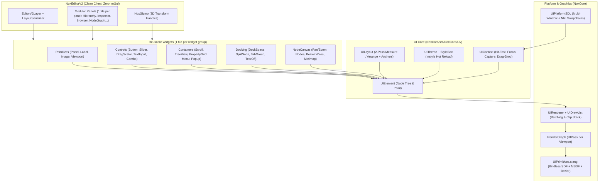

# Custom GUI System Architecture & Integration Plan

> **Target:** Replace Dear ImGui, `ImGuizmo`, and `thedmd/imgui-node-editor` in **Noxiouse** (`NoxCore` + `NoxEditor`), while optionally enabling runtime game UI in `NoxRuntime` / `NoxScriptCore`.  
> **Date:** November 2026  
> **Status:** Proposal / Pre-implementation

---

## 1. What Noxiouse Already Has (Audit from `docs-site` & `NoxCore`)

Before designing a GUI system from scratch, it is important to leverage what the engine already provides:

1. **Windowing & OS Integration (`SDL3`)**:
   - [`Window.cpp`](file:///E:/dev/noxiouse/NoxCore/src/NoxCore/Core/Window.cpp) already uses **SDL3** (`SDL_WINDOW_VULKAN | SDL_WINDOW_HIGH_PIXEL_DENSITY`), event polling, DPI awareness, relative mouse capture, and native file open/save dialogs ([`Utils.cpp`](file:///E:/dev/noxiouse/NoxCore/src/NoxCore/Utils/Utils.cpp)).
   - SDL3 natively supports **multiple `SDL_Window*` instances**, borderless windows with `SDL_HitTest` (for custom titlebars/docking), IME text input, and clipboard access.
2. **Graphics & Render Graph (`NRI` + `RenderGraph`)**:
   - Pure abstract `NRI` layer ([`NoxCore/src/NRI/`](file:///E:/dev/noxiouse/NoxCore/src/NRI/)): **100% bindless** via `VK_EXT_descriptor_heap` + 64-bit Buffer Device Address (BDA) push constants, `VK_KHR_unified_image_layouts` (all images stay in `GENERAL`), and Slang shaders compiled to SPIR-V 1.6 with live hot reload (`NOXWatcher`).
   - **Architectural win:** Today, `DeviceVK` has to maintain a legacy `VkDescriptorPool` *solely* for Dear ImGui's Vulkan backend. Replacing ImGui with an NRI-native GUI eliminates the last non-bindless descriptor pool in the engine (aside from the Streamline workaround).
3. **2D & Text Primitives (`Renderer2D` + `Font`)**:
   - [`Font`](file:///E:/dev/noxiouse/NoxCore/src/NoxCore/Renderer/Font.h) already generates and caches **MSDF (Multi-channel Signed Distance Field)** font atlases via `msdf-atlas-gen`. MSDF text stays razor-sharp at any scale — ideal for DPI scaling and zoomable node graphs.
   - [`Renderer2D`](file:///E:/dev/noxiouse/NoxCore/src/NoxCore/Renderer/Renderer2D.h) already has a screen-space mode (`BeginScreenSpace`/`EndScreenSpace`) used by `NoxRuntime`'s ImGui-free [`StatsOverlay`](file:///E:/dev/noxiouse/NoxCore/src/NoxCore/Profiling/StatsOverlay.cpp).
4. **Node Graph Decoupling (`INodeGraphCanvasBackend`)**:
   - [`INodeGraphCanvasBackend.h`](file:///E:/dev/noxiouse/NoxEditor/src/Panels/NodeGraph/INodeGraphCanvasBackend.h) already decouples `NodeGraphEditorPanel` (`.nanimgraph` and `.nmatgraph`) from `thedmd/imgui-node-editor`. Swapping the node-graph backend is already architected for!
5. **Existing UI Surface Area to Migrate**:
   - `ImGuiLayer` (`NoxCore/src/NoxCore/ImGui/`), `ImGuizmo` (3D viewport gizmos), `thedmd/imgui-node-editor`.
   - 11+ Editor Panels in `NoxEditor/src/Panels/`: `SceneHierarchyPanel` (hierarchy + 49-component Inspector), `ContentBrowserPanel`, `MaterialEditorPanel`, `NodeGraphEditorPanel`, `AnimationClipPanel`, `TimelinePanel`, `RenderGraphPanel`, `ProfilerPanel`, `WorldPartitionPanel`, `Levels`, `Output Log`, `StatsWindow`, plus multi-viewport (`ExtraViewPasses.cpp`, up to 7 secondary 3D views).

---

## 2. Retained Mode vs. Immediate Mode — What Big Engines Use

### How Major Engines Build Their UI

| Engine | Editor UI System | Runtime Game UI | Architecture | How Customization & Theming Work |
| :--- | :--- | :--- | :--- | :--- |
| **Unreal Engine 5 / 6** | **Slate** (pure C++) | **UMG** (wraps Slate) + CommonUI | **Retained** widget tree with declarative C++ (`SNew(SButton)...`) and `TAttribute<T>` reactive data binding | `FSlateStyleSet` / `FSlateBrush` (9-slice boxes, rounded boxes, fonts, colors) + two-pass layout (`ComputeDesiredSize` -> `ArrangeChildren`) |
| **Godot 4** | **Control** nodes (written in C++ using its own UI!) | **Control** nodes (same system) | **Retained** scene-tree nodes (`Container`, `HBoxContainer`, `GraphEdit`, `SplitContainer`) | Cascading **`Theme`** resource (`StyleBoxFlat` with corner radii, borders, shadows, margins, colors, fonts) inherited down the tree |
| **Unity (Modern)** | **UI Toolkit** (migrating off legacy IMGUI) | **UI Toolkit** (or uGUI Canvas) | **Retained** `VisualElement` tree + **Yoga** Flexbox layout + UXML/USS | **USS** (CSS subset: selectors, `:hover`/`:active`, transitions, variables, borders, radii) |
| **Dear ImGui** | (Third-party tool UI) | Not meant for game UI | **Immediate** (no persistent widget tree; rebuilt every frame) | `ImGuiStyle` global struct / `PushStyleColor`; hard to do complex layouts, animations, shadows, or CSS-like styling |

### Which Should Noxiouse Use?

**Recommendation: A Retained-Mode Core with Declarative C++ Ergonomics & Cascading Themes (Unreal Slate + Godot `Theme`/`StyleBox` hybrid).**

Why **Retained Mode** fits your requirements better than Immediate Mode:
1. **Easy, Deep Customization (Themes & Look)**:
   - In Immediate Mode, layout and drawing happen in the same call, making multi-pass styling (auto-sizing containers, right-aligned items, rounded borders, drop shadows, hover/press color animations, backdrop blur) awkward or 1-frame-laggy.
   - In Retained Mode, **Structure** (widget tree), **Style** (`StyleBox` / `UITheme` tokens), **Layout** (2-pass measure & arrange), and **Rendering** (batched GPU SDF primitives) are cleanly separated. Changing the entire look of the editor becomes editing a `.nstyle` (YAML/JSON) theme file with hot reload.
2. **Docking, Multi-Viewport, and Node Graphs**:
   - Docking splitters, tab groups, tear-off OS windows, virtualized lists (for 10,000+ scene entities), and zoomable node-graph canvases naturally have persistent state (scroll offsets, pan/zoom, tab order, splitter ratios, animation timers). Retained widgets own this state cleanly instead of stuffing it into string-hashed `ImGuiStorage` maps.
3. **Performance on Static Panels**:
   - Retained trees only re-run layout when marked dirty (`InvalidateLayout()`) and can cache/cull clipped children, whereas IMGUI re-evaluates every widget every frame.
4. **One System for Editor AND Game Runtime**:
   - Unlike Dear ImGui, a retained `UIElement` tree + `UITheme` can later be exposed to `NoxRuntime` and `NoxScriptCore` (C#) so games made in Noxiouse get a full, themeable UI system for free.

> **Keeping ImGui-like speed for quick tools:** You can build a lightweight **declarative/reactive helper** on top of the retained tree (similar to Slate's `SNew` / `TAttribute<T>` lambdas, or a `UIBuilder` that diffs/reconciles debug panels like `StatsWindow`) so writing a quick debug drawer is still only a few lines of C++.

---

## 3. Recommended Tech Stack (Minimal, Engine-Native)

| Responsibility | Choice | Why |
| :--- | :--- | :--- |
| **OS Windows, Input, DPI, Cursors, IME** | **SDL3** (already in `NoxCore`) | Zero new dependency. Supports multiple `SDL_Window*`, high-DPI scaling, `SDL_HitTest` for custom window chrome/docking, clipboard, file drops. |
| **Layout Engine** | **Custom 2-Pass Layout (`Measure` → `Arrange`)** (Slate + Godot style, no Yoga) | Zero external dependency (~800–1,200 LOC). Combines Unreal Slate's 2-pass `ComputeDesiredSize` / `ArrangeChildren` with Godot's **Anchors** (0..1 screen-relative pinning) and **Containers** (`HBox`, `VBox`, `Grid`, `Margin`, `Splitter`, `Overlay`, `Scroll`). |
| **Text Rendering** | **`msdf-atlas-gen` + `Nox::Font`** (already in `NoxCore`) | Already integrated! Crisp at any DPI and any zoom level in Node Graphs. *(Optional later: `HarfBuzz` for complex Unicode/ligatures, `LunaSVG` for vector icons.)* |
| **GPU UI Renderer** | **Custom NRI + Slang SDF Uber-Shader** | 100% bindless (`VK_EXT_descriptor_heap` + BDA). Single instanced/mesh-shader pass per viewport drawing SDF rounded rects, per-corner radii, borders, soft shadows, gradients, MSDF text, textures (e.g. 3D viewports!), and cubic Bezier curves. |
| **Theming & Styling** | **Cascading `UITheme` + `StyleBox` + State/Class Selectors (`.nstyle` YAML)** | Combines Godot's `StyleBoxFlat` (radii, borders, shadows, gradients) + Unreal's `FSlateStyleSet` tokens + CSS-style class/state selectors (`Button.primary:hover`) with smooth `dt` transitions & `NOXWatcher` live hot reload. |
| **Node Graph Canvas** | **Custom `NoxCanvas` implementing `INodeGraphCanvasBackend`** | Replaces `thedmd/imgui-node-editor`. Uses the same SDF renderer + MSDF text + spatial quadtree/AABB culling for smooth 60+ FPS pan/zoom. |
| **3D Viewport Gizmos** | **Custom `NoxGizmo` module** (replacing `ImGuizmo`) | Projects 3D axes/rings/planes using `EditorCamera` + draws via `Renderer2D` or `UIRenderer` with exact ray/segment hit-testing. |

---

## 4. Modular Architecture & File Breakdown (Separation of Concerns)

To avoid monolithic multi-thousand-line files, `Nox::UI` is split into **small, single-responsibility files** across four strict layers: **Rendering (GPU)** → **Core (Tree, Input, Theme, Layout)** → **Widgets (Controls, Containers, Docking, Graph)** → **NoxEditorV2 (Editor Panels)**.

### 4.1 Dependency & Data-Flow Graph

### 4.2 File-by-File Map (Small, Focused Files)

#### A. `NoxCore/src/NoxCore/UI/` (Shared by `NoxEditorV2` and `NoxRuntime`)
- **`Core/`**
  - `UITypes.h` — `UIRect`, `UIVec2`, `UIColor`, `CornerRadius`, `Thickness`, `Anchor` presets.
  - `UIElement.h/.cpp` — Base retained node: parent/children, `DirtyFlags` (`Layout`/`Paint`), `ComputeDesiredSize`, `ArrangeChildren`, `OnPaint`, `OnEvent`.
  - `UIContext.h/.cpp` — Per-window input router: hit-testing, hover/active/focus tracking, pointer capture, keyboard/IME, tooltips, drag-and-drop payloads.
  - `UITheme.h/.cpp` — `StyleBox` (fill, gradient, 4-corner radii, border, shadow, padding), class/state selectors (`:hover`, `:pressed`, `:disabled`), `dt` transitions, `.nstyle` YAML loader + `NOXWatcher` hot reload.
  - `UIBindings.h` — Lightweight `TAttribute<T>` / `Observable<T>` getter/setter helpers for reactive data binding.
- **`Layout/`**
  - `UILayout.h/.cpp` — `BoxLayout`, `StackLayout` (`HBox`/`VBox`), `GridLayout`, `AnchorLayout` (2-pass `Measure` → `Arrange` with `Fill`/`Expand` flags).
- **`Rendering/`**
  - `UIDrawList.h/.cpp` — High-level draw commands (`AddRoundedRect`, `AddText`, `AddImage`, `AddBezier`, `PushClipRect`/`PopClipRect`).
  - `UIRenderer.h/.cpp` — Converts `UIDrawList` into flat `UIPrimitive` & `UIClipRect` GPU buffers and records the `UIPass` in `RenderGraph`.
- **`Platform/`**
  - `UIPlatformSDL.h/.cpp` — Manages secondary `SDL_Window*`s + `NRI::Swapchain`s for multi-viewport tear-off windows, `SDL_HitTest` custom titlebars, and OS cursors.
- **`Widgets/`** *(each widget stays ~100–300 LOC)*
  - `UIPanel.h/.cpp`, `UILabel.h/.cpp`, `UIImage.h/.cpp` (supports Render Graph 3D viewport textures)
  - `UIButton.h/.cpp`, `UICheckBox.h/.cpp`, `UISlider.h/.cpp`, `UIDragScalar.h/.cpp`
  - `UITextInput.h/.cpp`, `UIComboBox.h/.cpp`, `UIColorPicker.h/.cpp`
  - `UIScrollView.h/.cpp`, `UITreeView.h/.cpp` (virtualized rows for 10k+ entities), `UIPropertyGrid.h/.cpp`
  - `UIMenuBar.h/.cpp`, `UIPopup.h/.cpp`
  - `UIDockSpace.h/.cpp` (binary `SplitNode` + `TabGroup` + drag-to-dock overlay + tear-off to `UIPlatformSDL`)
  - `UINodeCanvas.h/.cpp` (pan/zoom grid, SDF nodes, Bezier wires, minimap, box selection)
  - `UICurveEditor.h/.cpp` (for `TimelinePanel` / `ProfilerPanel`)

#### B. `NoxEditor/assets/shaders/UI/`
- `UIPrimitives.slang` — Bindless SDF uber-shader (`RoundedRect`, `MsdfGlyph`, `TexturedQuad`, `CubicBezier`, GPU `clipRectIndex`).

#### C. `NoxEditorV2/src/` (Clean Second Editor Executable — Renamed to `NoxEditor` at Parity)
- `Main.cpp`, `EditorV2Layer.h/.cpp` — Entry point, `DockSpace` setup, layout persistence, and menu bar.
- `Viewport/NoxGizmo.h/.cpp` — Custom 3D transform gizmos (replacing `ImGuizmo`).
- `Panels/` — One file pair per panel (`SceneHierarchyPanel`, `InspectorPanel`, `ContentBrowserPanel`, `MaterialEditorPanel`, `NoxCanvasBackend` implementing `INodeGraphCanvasBackend`, `TimelinePanel`, `RenderGraphPanel`, `ProfilerPanel`, `WorldPartitionPanel`, `LevelsPanel`, `OutputLogPanel`).

### 4.2 The GPU-Driven SDF UI Shader (`UIPrimitives.slang`)

Instead of tessellating rounded corners and shadows into thousands of CPU triangles like Dear ImGui, each UI primitive is a single **64–96 byte `UIPrimitive` struct** in a per-frame BDA storage buffer, rendered as a single instanced/mesh-shader pass:

- **Primitive Types**:
  1. `RoundedRect`: Center, half-size, 4-corner radii, fill color/gradient, border thickness & color, soft drop-shadow radius/offset/color. Evaluated analytically per pixel with `fwidth` anti-aliasing.
  2. `MsdfGlyph`: Quad bounds, atlas UV, bindless `fontAtlasSlot`, foreground color, optional outline.
  3. `TexturedQuad`: Quad bounds, UV rect, bindless `textureSlot` (used for icons, thumbnails, and **embedding 3D Render Graph viewport textures directly in panels**), tint, corner radius clipping.
  4. `CubicBezier`: 4 control points, thickness, color, optional dashed/animated flow (for node-graph wires and timeline curves).
- **Clipping**: Each primitive stores a `clipRectIndex` pointing into a small array of scissor/clip rects in the same frame buffer — **no draw-call splitting required for nested scroll views!**
- **Optional Glassmorphism**: Because `UIPass` runs inside `RenderGraph`, a panel flagged `BackdropBlur` can sample a downsampled blur of the underlying scene/UI texture.

### 4.3 Multi-Viewport & Docking Integration

1. **DockTree**: Binary tree of `SplitNode` (horizontal/vertical with draggable splitter ratio) and `LeafTabGroup` (list of docked `Panel`s + active tab index). Serialized to `EditorLayout.yaml`.
2. **Multi-Viewport (Floating OS Windows)**:
   - Dragging a tab out of a `LeafTabGroup` spawns a borderless `SDL_Window*` + `NRI::Swapchain` managed by `UIPlatformSDL`.
   - Each OS window has its own `UIViewport` root and records a lightweight `UIPass` in `RenderGraph` (or a dedicated swapchain present pass) so floating panels, detached 3D viewports, and menus render natively across multiple monitors.
   - `SDL_HitTest` lets custom-styled titlebars behave like native OS windows (Aero Snap, drag-to-maximize, resize edges).
   - **Built (2026-11-16 fix):** each floating window (`UIViewport`) uploads its UI into its own `UI::UIUploadBuffers` (one primitive + clip
     buffer pair per frame slot, 32768 primitives / 2048 clip rects), written from the start after its swapchain's `acquireNextImage` waited
     for the slot's previous submission. Before, floating windows wrote into the main window's per-frame buffers, which the main frame only
     guards with its own fences: the next main frame could overwrite primitives a floating window's GPU work was still reading (flicker or
     garbage in a floating panel). Checked by compiling only; not yet tested on the GPU.
   - **Validation note:** with Vulkan Configurator's synchronization validation on, `SYNC-HAZARD-WRITE-AFTER-PRESENT` at `vkQueuePresentKHR`
     appears once a scene's meshes stream in. It is a validation-layer limitation, not an engine or UI bug: the frame waits on the sparse
     geometry timeline, which only `vkQueueBindSparse` signals, and syncval does not track sparse binding ("No dedicated support for sparse
     resources" in its docs, still true in the 2026-11-16 sources). Confirmed by the user: the message disappears with sparse buffers off.

---

## 5. Phased Implementation Roadmap

### Phase 0: NRI Bindless UI Renderer & Render Graph Pass
- Define `UIPrimitive`, `UIClipRect`, and `UIPushConstants` in `shaderIO.h`.
- Write `UIPrimitives.slang` (SDF rounded rect + border + shadow, MSDF text, textured quad, cubic Bezier).
- Implement `UIRenderer` + `UIDrawList` and register `UIPass` in `RenderGraph` (`Renderer.cpp` / `Passes/EditorPasses.cpp`).
- **Verify:** Draw a styled test overlay with rounded panels, shadows, and MSDF text on top of the main viewport.

### Phase 1: Retained Widget Core, Layout, Input & Theming
- Implement `UIElement` tree, `UIContext` (pointer hit-testing, hover/active/focus states, keyboard/IME routing, drag-and-drop, cursor shapes), and 2-pass layout (or Yoga integration).
- Implement `UITheme` & `StyleBox` with YAML serialization and `NOXWatcher` hot reload.
- **Verify:** Live-edit a `.nstyle` theme file and watch panel colors, radii, borders, and fonts update immediately.

### Phase 2: Essential Editor Controls & Data Binding
- Build core widgets: `Label`, `Button`, `CheckBox`, `Slider`, `DragScalar` (scrubbable numbers like Blender/Unreal), `TextInput` (selection, undo, copy/paste), `ComboBox`, `ColorPicker`, `ScrollView`, `CollapsibleSection`.
- Build virtualized `TreeView` (only instantiates/lays out visible rows — essential for 10,000+ entity scenes) and `PropertyGrid` with `TAttribute`-style getter/setter bindings.
- **Verify:** Port a simple panel (e.g. `StatsWindow` or `Levels`) to `Nox::UI`.

#### Inspector widgets pass (2026-11-16, after the first test of InspectorV2)

What the user hit in the Inspector's material rows, and what each one was in the code:

| Seen | Cause | Now |
|---|---|---|
| Scroll bar hard to grab, no highlight | Each scrolling widget drew its own 5 px thumb; a press was only the bar's when no child lay under it, and the pointer capture stayed with that child, so the drag never followed | `UI::UIScrollBar` (one implementation for `UIScrollView`, `UITreeView`, `UILogView`, `UITableView`): a 12 px lane that takes the pointer before the content, thumb grabbed where it is pressed, wider and brighter under the pointer, accent colour while dragged, lit for a moment after the wheel. Painted after the children (`UIElement::OnPaintOverlay`), children clipped beside it (`GetChildClipRect`) |
| A long `.nmat` name drawn over the scroll bar | Layout was right, painting was not: text was drawn in full whatever its bounds | `UILabel::Elide` (default `End`, `Middle` for asset names; `UILabel::ElideText`): a line that does not fit ends in "...". `UIButton::TextElide`; a shortened button shows its full text as the tooltip. Card headers shorten their title |
| Colour: small hex text, no picker on click | `UIColorEdit` was given the context of the moment the panel was built -- none, the Inspector builds outside of events -- and returned when it was null (dropdowns had the same bug) | Popups open in the context of the click (`UIContext::GetCurrent()`). `UIColorEdit`: swatch + R / G / B (/ A) number fields 0-255 (they leave when the row is narrow); a click on the swatch opens the picker (`UI::UIPopup`, kept inside the window): saturation / value square, hue and alpha bars, new colour beside the old one (click it to go back), RGB, HSV and hex fields |
| Metallic / Roughness: a slider, no way to type | `UISlider`'s text edit hid behind a double click, and its first click moved the value | `UIDragScalar` is the one number field: drag = scrub (relative, Shift ten times finer), click = type (Enter / Tab / click elsewhere apply, Escape cancels, "," read as "."). `ShowFill` + a range makes it the slider (Unreal's numeric entry box). `InspectorCardBuilder::AddSlider` uses it |
| "Quick Edit" as a second button and a nested card | -- | One row per slot: chevron (the material's properties in place, as Godot and Unity open a resource), name (pick), **Edit** (the Material Editor panel, as Unreal opens the asset), three dots (Make Unique, Reset) |

Found on the way and fixed: `InspectorCardBuilder`'s editors captured `this` -- the builder, a local of the function filling the card -- and
called `OnMutate` through it after it was gone (they keep a copy now); `PopulateMaterialPropertiesUI` kept a reference to its callbacks
argument, a temporary; `UIButton` measured with the style's padding but arranged with style + own padding (own padding now replaces the
style's, and gives way before a fixed-size button's text is cut); a field of a closed popup or a rebuilt panel could still receive keys
(`UIContext::SetOverlay` / `DropDetachedInput`, `UIElement::OnFocusChanged`).

Then (user test: "clicking the arrow flashes the whole inspector"): `UIContext::UpdateAndRender` laid elements out before resolving
their styles, so an element made or shown this frame (a rebuilt panel, an opened section) was measured with the default style (padding 8
instead of the theme's) and drawn up to 60 px off for one frame. Styles are now resolved first, then layout, then the hover is updated at
the resting pointer (new content under it is hovered at once), then paint. The slot arrow no longer rebuilds the Inspector: its section is
built the first time it opens and only shown / hidden after that.

Checked: clang syntax check of every UI and NoxEditorV2 source; a headless test of the real widget code with fake input (68 checks, rebuild and open-section layout included: lane hit
test and capture, thumb grab without a jump, elision inside the lane, scrub / type / clamp / Escape, picker opens from a context-less editor
and stays in the window, hex parsing, input dropped for a rebuilt panel) and pictures of its draw lists. **Not run on a GPU**; the test is
not in the repository yet (it needs a stand-in for the font and the draw list). **Not yet:** a popup cannot leave its OS window (a picker
opened in a small floating panel window is squeezed into it); `UISlider` itself is unchanged (animation time, players).

#### Content Browser, thumbnails, Output Log, status bar and toasts (2026-11-16)

The user asked for the old Content Browser and its thumbnails back, redesigned: Unreal-style tiles, no prototype controls, rendered
pictures, the log as a tab beside it, a working Reset Layout, readable transform fields, and the notification system in the status bar.

Flaws of what was there before (NoxEditor's ImGui browser and the state of NoxEditorV2):

| Flaw | Now |
|---|---|
| Old browser: file-icon image buttons, names cut by a clip rect, no type label or colour, a toolbar with prototype controls (Tools, a tile-size slider, an up arrow), no Material creation, a modal for everything | `Panels/ContentBrowserV2Panel` (new): tiles like Unreal's -- a card with a shadow, the picture on top, a 3 px line in the type's colour, the name on up to two lines ending in "...", the type at the bottom right, small and muted. Folder tree on the left, toolbar `+ Add`, `Import`, `<` `>`, breadcrumb, search, type filter, `View` (Small / Medium / Large Tiles, Refresh, Show in Explorer). Footer: item count and selection |
| V2 had no Content Browser and no thumbnails | `Panels/AssetPreviewRenderer` (from NoxEditor) renders meshes, prefabs and material spheres with the thumbnail view and keeps them in `<Project>/Cache/Thumbnails`; textures show the texture itself in its proportions; everything else shows a vector icon of its type (cube, figure, sphere, picture, globe, node graph, bone, play, film strip, "Aa", speaker, `</>`). Saving a material in the Inspector redraws its sphere |
| V2 had no Output Log | `Panels/OutputLogV2Panel` (new): filter chips Errors / Warnings / Messages / Verbose with counts, search (every word), Copy, Clear, line selection (click, Shift, Ctrl, Ctrl+A, Ctrl+C, right-click menu), follows new lines at the bottom, the Cmd line (Tab completes -- `UIElement::CapturesTab` keeps Tab in the field --, Up / Down history, matching names listed above it). The ` key opens it |
| Reset Layout did not work | It rebuilt the UI inside the menu's own click (`SetRoot` while the event was being dispatched), left torn-off OS windows open and the old file in place, and the layout was saved into the engine's `assets/layouts` (in git). Now Reset runs at the start of the next frame: closes the OS windows (`UIViewportManager::Shutdown`), deletes the saved files, builds the default layout and saves it. Layout files live in `<Project>/Saved/Layout` (per project, like Unreal's `Saved/Config`); the three files in `NoxEditor/assets/layouts` are removed |
| Transform fields: the last digit hidden | Rows gave the label 39 % and the fields had lettered tags at font 18. `InspectorPropertyRow`: label `clamp(0.34 w, 76, 150)` px, the value the rest; axis fields with a coloured stripe instead of a letter, font 15, three decimals with trailing zeros dropped (`TrimZeros`), and a number too wide for its field drops decimals until it fits (123.456 -> 123.46 -> 123.5 -> 123; typing shows every digit) |
| Status bar was one label; toasts were plain text | Status bar: left a dot (green Ready / amber pulsing busy) and what runs (import progress, script build, scene opening, assets loading, textures streaming, MB to upload, BLAS builds); right the log's warnings and errors (click: the Output Log). `UIContext::PushNotification` (`UINotification`: Info / Success / Warning / Error, title, message): 340 px cards at the bottom right above the status bar, severity icon and stripe, slide and fade, a hovered toast waits, a click dismisses |

Toasts come from: scene saved / not saved, scene opened / not readable, project opened / not opened, layout saved / reset, script build
result (time, warnings, errors), model import started / finished, prefab created, assets moved / deleted / renamed (failures), files
imported, an asset with no V2 editor yet. Running work stays in the status bar (it is not a toast).

Also built: drag tiles into the viewport (meshes and prefabs placed on the surface under the pointer, else the ground plane; a scene
opens), onto a folder tile (moves them), entities from the hierarchy onto the tiles (a prefab in that folder; also the hierarchy's
Create Prefab), files dropped from the system (imported into the open folder; a model opens the import dialog first: static / skeletal
meshes, combine modes, animations, scale, file name), inline rename (F2), Duplicate, Delete with the users listed (files and the open
scene), Find References, Reimport, Copy Path, Show in Explorer, + Add: folder, Material, Material Graph, Material Shader, Animation Graph,
Audio Graph, Timeline, C# Script. Double-click: folder, scene, material (others: a toast that V2 has no editor for them yet). Keys typed
in the browser or the log no longer reach the editor's shortcuts (Delete deleted the selected entities as well).

Found by the headless test and fixed: every modal dialog's buttons were dead -- a press inside the dialog bubbled up to the backdrop,
which closed it before the button saw the release (the Delete and import confirmations would never have run); the buttons also called
their action through the lambda the close had destroyed (now copied first). `PickWorldPoint` used the depth of the last pick request
even when the pointer had moved since (pick requests pause during a drag); now only within 6 px of the pointer, else the ground plane.

Checked: clang syntax check of every touched source; the headless test (78 checks; new: toasts placed above the inset, click dismiss,
time-out, a hovered toast waits; transform numbers inside their fields at 200 px with their integer part; CapturesTab; custom modal
button order and primary action). **Not run on a GPU or on Windows; not user-tested.** **Not yet:** prefab variants and Replace
References from the browser, the asset preview panel (rotating live preview), audio preview, opening graphs / timelines in V2 (their
editors are not ported).

#### After the first test of the Content Browser (2026-11-19)

| Seen | Cause | Now |
|---|---|---|
| + Add, Settings (View) and the type filter "do nothing" | The menus opened, but a press on one of their rows bubbled up to the menu's invisible backdrop, which closed the menu before the row saw the release: no menu item or dropdown choice anywhere ran (the dialog bug fixed before, in every popup) | `UIElement::AnyChildContains`; the backdrops of context menus, menu bars, dropdowns, popups, the command palette, the Inspector's slot popup and dialogs dismiss only on a press outside their popup |
| Import: "Invalid dialog file filters" | SDL's dialogs take extensions only (`gltf;glb`), the filter had `*.gltf;*.glb` | The browser's filter fixed; `Utility::OpenFile` / `SaveFile` turn `*.ext` patterns into SDL's form |
| Wheel over the tiles does nothing, the folder tree stops half way | Every refresh of the open folder put the tiles back at the top and gave the tree new rows; while a big folder's textures are loaded and cooked, files arrive in it many times a second | A refresh of the same folder / search / filter keeps the scroll position and selection; the tree keeps its rows unless its folders changed; the registry and folder checks run twice a second at most |
| NOXWatcher lines for `.idea/workspace.xml` | Rider writes its workspace files inside `Assets/Scripts/build` | The watcher ignores dot-folders (`.idea`, `.vs`, `.git`, `.vscode`) under the watched one |
| Bars of uneven height, the path a row of big buttons, search squeezed | The generic breadcrumb used the theme's button padding | Unreal's layout: row 1 `+ Add`, `Import`, `<` `>`, a text path bar with chevrons (`ContentPathBar`: first folders give way to "..."), `Dock in Layout`, `Settings`; row 2 over the tiles: type filter + search across the width; every control 26 px |
| Small text | -- | Status bar "Ready" 15 px, Output Log lines 15 px (rows 22 px), level chips 14.5, Cmd 15, tile type label 12.5 and brighter |
| Bottom tabs take space from the viewport | They were docked | Unreal's Content Drawer: the status bar's **Content Drawer** (Ctrl+Space) and **Output Log** (`) tabs slide the page up over the viewport (`EditorCenterArea`, which does not resize the viewport); a click outside, Escape or dragging an asset out closes it; its top edge resizes it. **Dock in Layout** docks a page under the viewport, Window > ... **Back to Drawer** returns it. The default layout has nothing docked at the bottom; the layout file is `EditorV2.2.nlayout` (older ones start fresh once) |

Then (user test: "added a material, delete freezes the program"): Delete first asks which project files use the asset, and
`EditorAssetManager::FindReferences` read every file that can name an asset -- every cooked mesh too, hundreds of MB for Bistro -- and
indexed every number and text run in it, on the main thread. Now: `FindReferencesIn` works on a copy of the registry on a worker thread
(the browser shows the dialog when the answer is there; the status bar says "Looking for what uses ..."); materials and meshes are read
only for a texture, material graph or material shader (the only assets they carry inside); a file is searched for the handle's digits
and the asset's file name (case ignored) and only the text around a hit is judged. An offline comparison with the old test gives the
same answers on handles, longer numbers, upper-case and absolute paths, binary strings and unrelated files; a 300 MB mesh takes 1.9 s
instead of 5.2 s, and a material's delete does not read meshes at all. Not timed on the user's project.

Then ("delete works but is insanely slow, how do big engines do it?"): they never read the project to answer "who uses this?"
-- Unreal's asset registry keeps every package's dependencies (gathered when it is saved or scanned, cached on disk), Unity's
AssetDatabase and Godot's file system cache do the same. Nox now has that cache: `AssetReferenceIndex` (NoxCore/Asset) keeps, for every
file that can name assets, the handles and paths it names, with the file's size and write time. Built on a background thread when the
project opens (the status bar shows "Indexing asset references n / m"), saved to `<Project>/Cache/AssetReferences.nrefs` (the next
session reads only files that changed), checked against each file's size and time on every lookup (a changed file is read again).
`FindReferences` / `FindReferencesIn`, `FindUnusedAssets` and the browser's background check use it. A cooked mesh is read only up to its
metadata block (`MeshSerializer::MetadataEnd`: descriptors, materials, lights, nodes -- the geometry pages behind it name nothing), which
also speeds up packaging's dependency walk. Offline: a 400 MB mesh is read for references in 0.1 ms (whole: ~7 s), a cached lookup reads
no file, the next session reads nothing unchanged, an edited scene is read again, digits inside geometry pages are not taken for handles.

Checked: syntax check of every touched source with the vendors fetched; the headless test, rebuilt (the old one was lost with the
container): 15 checks with the real dock space, menus, dropdown, tree view and the real `ContentTileView` / `ContentPathBar` extracted
from the panel source (menu items and dropdown choices run, the wheel scrolls tiles and tree, a refresh keeps the scroll position, path
bar elision and click, toolbar controls one height). **Not run on a GPU or Windows; the drawer itself (`EditorCenterArea`) is not in the
headless test** (it lives in EditorV2Layer, which needs the renderer).

### Phase 3: Docking & Multi-Viewport
- Implement `DockSpace` (splitters, tab bars, drag-to-dock preview overlays, layout save/load).
- Extend `UIPlatformSDL` + `Renderer` to support secondary `SDL_Window*` + `NRI::Swapchain` viewports for torn-off panels and popups.
- **Verify:** Tear off the Content Browser onto a second monitor and dock it back.

### Phase 4: Node Graph (`NoxCanvas`), Timeline & Profiler
- Implement `NoxCanvasBackend` (`INodeGraphCanvasBackend`) using `Nox::UI`:
  - Infinite pan/zoom canvas with grid, minimap, box marquee selection, and spatial culling.
  - SDF nodes with custom embedded widgets (color swatch, 2D blend space grid, parameter bindings).
  - Cubic Bezier wires with distance-to-curve hit-testing and animated data flow.
- Build custom `CurveEditor` / `DopeSheet` for `TimelinePanel` and flamegraph canvas for `ProfilerPanel`.

### Phase 5: 3D Gizmos & Full ImGui Removal
- Replace `ImGuizmo` with `NoxGizmo` (3D translate/rotate/scale/universal handles + snapping).
- Migrate remaining panels (`SceneHierarchyPanel`, `ContentBrowserPanel`, `MaterialEditorPanel`, `RenderGraphPanel`, `WorldPartitionPanel`, `EditorLayer` menus/viewports).
- Remove `ImGuiLayer`, `NoxCore/vendors/imgui`, `ImGuizmo`, `imgui-node-editor`, and the legacy `VkDescriptorPool` in `DeviceVK`.

### Phase 6 (Optional): Runtime Game UI
- Expose `UIElement`, `UITheme`, and `UIDocument` to `NoxRuntime` and `NoxScriptCore` (C#), allowing games to build HUDs and menus with the exact same engine-native UI system.

---

## 6. Design Decisions Locked In

1. **Layout Engine (No Yoga):** Custom **2-Pass Measure/Arrange** (`ComputeDesiredSize` bottom-up → `ArrangeChildren` top-down) with **Anchors** (for responsive HUDs/overlays) + **Containers** (`HBox`, `VBox`, `Grid`, `Margin`, `Splitter`, `Overlay`, `Scroll`), matching Unreal Slate + Godot 4.
2. **Theme & Styling:** **Cascading `UITheme` + `StyleBox` + Class/State Selectors** in YAML (`.nstyle`), giving full visual freedom (radii, borders, gradients, shadows, icons, hover/press animations) with live hot reload.
3. **Clean Migration via Second Editor Client:** Build a clean **second editor target** (e.g. `NoxEditorV2` / `NoxStudio`) alongside `NoxEditor` (ImGui). Both share `NoxCore`, so there is zero ImGui pollution in the new UI and we can compare them side-by-side until `NoxEditorV2` reaches feature parity.
4. **Unified Editor + Game Runtime UI:** Design `Nox::UI` in `NoxCore` from day one so **both** `NoxEditorV2` and `NoxRuntime` / C# `NoxScriptCore` use the exact same widget tree, layout, and theming system (just like Unreal Slate/UMG, Godot `Control`, and Unity UI Toolkit).
