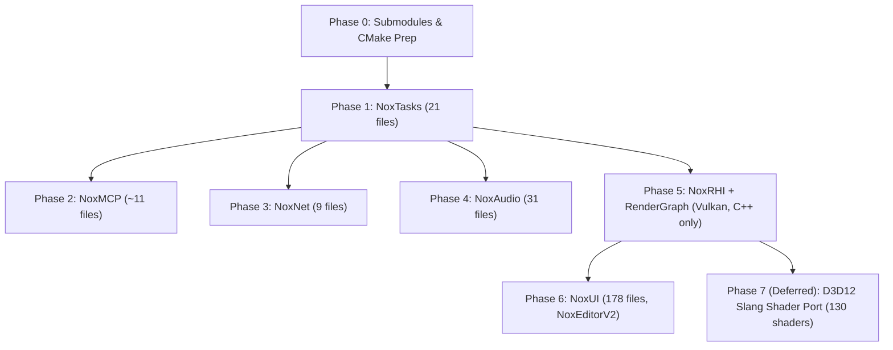

# Standalone Libraries Integration Plan (`NoxTasks`, `NoxMCP`, `NoxNet`, `NoxAudio`, `NoxRHI`, `NoxUI`)

> **Date:** 2026-11-23  
> **Scope:** Replacing Noxiouse's in-tree engine subsystems (`Tasks`, `Mcp`, `Network`, `Audio`, `NRI` + `RenderGraph`, `UI`) with the six standalone GitHub libraries under `VanKalanchoe/*`.  
> **Build baseline:** Windows x64, C++20, CMake 3.31+, Visual Studio 2026 (`ClangCL`), Vulkan SDK 1.4.350+.

---

## 1. Executive Summary & Answer on Slang Shaders

### Can we integrate `NoxRHI` with C++ code only and leave the `.slang` shaders untouched for now?

**Yes — and this is strongly recommended.**

An audit of `NoxRHI`'s `SlangCompiler.cpp` and `Vulkan` backend against Noxiouse's current `NRI` and 130 `.slang` files confirms:

1. **Vulkan compilation flags are 100% compatible:** On `NRI_GRAPHICS_API_VULKAN`, `NoxRHI`'s `SlangCompiler` emits `SLANG_SPIRV` (`spirv_1_6`) with `GLSLForceScalarLayout = 1`, `SLANG_MATRIX_LAYOUT_COLUMN_MAJOR`, `EmitSpirvDirectly = 1`, `VulkanUseEntryPointName = 1`, `spvDescriptorHeapEXT`, `spvRayQueryKHR`, and `-DNOX_VULKAN=1` — identical to Noxiouse's current `NoxCore/src/NRI/SlangCompiler.cpp`.
2. **Vulkan binding model is 100% compatible:** `NoxRHI` on Vulkan uses the exact same `VK_EXT_descriptor_heap` + `VK_KHR_unified_image_layouts` + BDA (`uint64_t` device addresses) + `VK_KHR_shader_untyped_pointers` model. All existing `Texture2D.Handle(...)`, `SamplerState.Handle(...)`, and `(T*)push.addr` shader code continues to work unchanged on Vulkan.
3. **Splitting C++ integration from D3D12 shader porting eliminates compounding risk:**
   - **Recommended Path (Two-Stage RHI Migration):**
     - **Stage A (Phase 5 — Code-Only, Vulkan Backend):** Swap `NoxCore/src/NRI/` and `NoxCore/src/NoxCore/RenderGraph/` for `NoxRHI::Core` + `NoxRHI::HPP` + `NoxRHI::RenderGraph` while keeping `NRI_GRAPHICS_API_VULKAN` as the active renderer API. **Zero edits are required to the 130 engine `.slang` shaders.** Validate visual and performance parity on Vulkan first.
     - **Stage B (Phase 7 — D3D12 Shader Porting):** Once the engine runs cleanly on `NoxRHI` (Vulkan), incrementally port the `.slang` shaders to cross-API (`nox_gpu.slang`, `BufferRef<T>`/`RWBufferRef<T>`, `LoadByte`, `LoadTlas`, `SV_DrawIndex` command signature, D3D12 buffer SRV/UAV registration) and enable `--dx12`.
   - **Bonus:** `NoxUI`'s renderer backend (`noxui_impl_noxrhi.h`) already embeds its own cross-API `UIPrimitives.slang`, so `NoxUI` works on both Vulkan and D3D12 out of the box.

---

## 2. Subsystem Mapping & Integration Order

The six libraries form a clean dependency DAG. Integrating them in **bottom-up dependency order** keeps every step small, reviewable, and independently compilable.



| Order | Standalone Repo | Replaces in Noxiouse | Include Impact | CMake Target(s) | Risk |
|---|---|---|---|---|---|
| **1** | `VanKalanchoe/NoxTasks` | `NoxCore/src/NoxCore/Tasks/*` | ~21 files | `NoxTasks::NoxTasks` | Very Low |
| **2** | `VanKalanchoe/NoxMCP` | `NoxMcp/src/Mcp/{Protocol,Server,Client,Validation,InputPlayer,TokenFiles}` | ~11 files | `NoxMcp::NoxMcp` | Very Low |
| **3** | `VanKalanchoe/NoxNet` | `NoxCore/src/NoxCore/Network/*` | ~9 files | `NoxNet::NoxNet` | Low |
| **4** | `VanKalanchoe/NoxAudio` | `NoxCore/src/NoxCore/Audio/*` | ~31 files | `NoxAudio::NoxAudio` | Medium |
| **5** | `VanKalanchoe/NoxRHI` | `NoxCore/src/NRI/*` & `NoxCore/src/NoxCore/RenderGraph/*` | ~30+ files (deep in `Renderer/`) | `NoxRHI::Core`, `NoxRHI::HPP`, `NoxRHI::RenderGraph` | High |
| **6** | `VanKalanchoe/NoxUI` | `NoxCore/src/NoxCore/UI/*` | ~178 files (`NoxEditorV2`) | `NoxUI::Core`, `NoxUI::SDL3`, `NoxUI::NoxRHI` | Medium |
| **7** | *(Engine Shaders)* | `NoxEditor/assets/shaders/**/*.slang` | 130 `.slang` files | N/A (D3D12 enablement) | High |

---

## 3. Phase 0 — Repository Layout & Upstream CMake Fixes

Before wiring any library into Noxiouse, prepare a clean vendor layout and fix four small CMake embedding issues found in the standalone repositories so Noxiouse does **not** duplicate SDKs (Slang, Streamline, NRD, VMA, SteamAudio, miniaudio, Taskflow, msdf-atlas-gen, cpp-httplib).

### Step 0.1 — Add Standalone Libraries as Git Submodules
Place all six repositories in a dedicated top-level folder (e.g., `external/` or `NoxCore/vendors/`):
- `external/NoxTasks` (`https://github.com/VanKalanchoe/NoxTasks.git`)
- `external/NoxMCP` (`https://github.com/VanKalanchoe/NoxMCP.git`)
- `external/NoxNet` (`https://github.com/VanKalanchoe/NoxNet.git`)
- `external/NoxAudio` (`https://github.com/VanKalanchoe/NoxAudio.git`)
- `external/NoxRHI` (`https://github.com/VanKalanchoe/NoxRHI.git`)
- `external/NoxUI` (`https://github.com/VanKalanchoe/NoxUI.git`)

### Step 0.2 — Upstream CMake Embedding Tweaks (Small PRs to Standalone Repos)
Check and patch these exact CMake lines in the standalone repos so `add_subdirectory(...)` works cleanly inside Noxiouse without duplicating `vendors/`:

1. **`NoxRHI/CMakeLists.txt`:**
   - Currently hardcodes `${CMAKE_CURRENT_SOURCE_DIR}/vendors/{VulkanMemoryAllocator-Hpp,D3D12MemoryAllocator,slang,Streamline,NRD}`.
   - Expose `CACHE PATH` override variables (`NOXRHI_VMA_DIR`, `NOXRHI_D3D12MA_DIR`, `NOXRHI_SLANG_DIR`, `NOXRHI_STREAMLINE_DIR`, `NOXRHI_NRD_DIR`) defaulting to `${CMAKE_CURRENT_SOURCE_DIR}/vendors/...`.
   - Guard `add_library(D3D12MemoryAllocator ...)` with `if(NOT TARGET D3D12MemoryAllocator)` so it does not collide if already defined.
   - *(Cleanup)* Remove the duplicate `if(NRI_ENABLE_NONE)` block after `add_library(NoxRHI ...)` (lines 144–149).
2. **`NoxUI/CMakeLists.txt`:**
   - Guard `add_subdirectory("${CMAKE_CURRENT_SOURCE_DIR}/vendors/msdf-atlas-gen" ...)` with `if(NOT TARGET msdf-atlas-gen::msdf-atlas-gen)` so it reuses Noxiouse's `msdf-atlas-gen` target from the root `CMakeLists.txt`.
3. **`NoxNet/CMakeLists.txt`:**
   - Support all vcpkg `GameNetworkingSockets` target names: check `GameNetworkingSockets::GameNetworkingSockets`, `GameNetworkingSockets::GameNetworkingSockets_s`, **and** `GameNetworkingSockets::shared` / `GameNetworkingSockets::static` (which Noxiouse's current vcpkg installation exports).
4. **`NoxMCP` `nlohmann/json`:**
   - Ensure `NOXMCP_JSON_DIR` points to Noxiouse's `nlohmann/json.hpp` (or vendor it once in `NoxCore/vendors/nlohmann`).

### Step 0.3 — Root `CMakeLists.txt` Integration Pattern
Disable standalone tests/examples for all six libraries from Noxiouse's root `CMakeLists.txt`:
```cmake
set(NOXTASKS_BUILD_EXAMPLES OFF CACHE BOOL "" FORCE)
set(NOXTASKS_BUILD_TESTS    OFF CACHE BOOL "" FORCE)
set(TASKFLOW_INCLUDE_DIR "${CMAKE_SOURCE_DIR}/NoxCore/vendors/taskflow" CACHE PATH "" FORCE)

set(NOXMCP_BUILD_TESTS   OFF CACHE BOOL "" FORCE)
set(NOXMCP_HTTPLIB_DIR   "${CMAKE_SOURCE_DIR}/NoxCore/vendors/cpp-httplib" CACHE PATH "" FORCE)
set(NOXMCP_JSON_DIR      "${CMAKE_SOURCE_DIR}/NoxCore/vendors/nlohmann" CACHE PATH "" FORCE)

set(NOXNET_BUILD_TESTS   OFF CACHE BOOL "" FORCE)

set(NOXAUDIO_BUILD_TESTS   OFF CACHE BOOL "" FORCE)
set(NOXAUDIO_MINIAUDIO_DIR "${CMAKE_SOURCE_DIR}/NoxCore/vendors/miniaudio" CACHE PATH "" FORCE)
set(NOXAUDIO_STEAMAUDIO_DIR "${CMAKE_SOURCE_DIR}/NoxCore/vendors/steamaudio" CACHE PATH "" FORCE)

set(NRI_BUILD_EXAMPLES    OFF CACHE BOOL "" FORCE)
set(NRI_STATIC_LIBRARY    ON  CACHE BOOL "" FORCE) # or OFF if DLL boundary is desired
set(NRI_ENABLE_D3D12      ON  CACHE BOOL "" FORCE) # compiled in; engine stays on Vulkan until Phase 7

set(NOXUI_BUILD_EXAMPLES  OFF CACHE BOOL "" FORCE)
set(NOXRHI_DIR            "${CMAKE_SOURCE_DIR}/external/NoxRHI" CACHE PATH "" FORCE)
```

---

## 4. Phase 1 — Integrate `NoxTasks`

**Why first:** Zero engine dependencies, only ~21 include sites, and `NoxNet`, `NoxAudio`, and `NoxRHI::RenderGraph` all accept `NoxTasks` hooks.

### Steps
1. **CMake:**
   - Add `add_subdirectory(external/NoxTasks)` before `NoxCore`.
   - Link `NoxTasks::NoxTasks` as `PUBLIC` on `NoxCore`.
   - Remove `${CMAKE_CURRENT_SOURCE_DIR}/vendors/taskflow` from `NoxCore/CMakeLists.txt` (Taskflow stays private inside `NoxTasks`).
2. **Startup Hooks (`Application.cpp`):**
   - Before constructing `NoxTasks::JobSystem`, wire:
     - `NoxTasks::SetLogCallback(...)` -> forward to `NOX_CORE_INFO` / `NOX_CORE_WARN` / `NOX_CORE_ERROR`.
     - `NoxTasks::SetProfilerCallbacks(...)` -> forward to `Nox::Profiler` / Tracy macros (`NOX_PROFILE_SCOPE` / thread naming).
3. **Header & Namespace Migration:**
   - Update the ~21 files including `NoxCore/Tasks/{JobSystem,SystemGraph,FrameArena,WorkerLocal}.h` to `#include <NoxTasks/NoxTasks.h>` (or individual headers).
   - Either update `Nox::JobSystem` / `Nox::SystemGraph` / `Nox::FrameArena` / `Nox::WorkerLocal` / `Nox::JobPriority` / `Nox::ComponentAccess` to `NoxTasks::*`, **or** keep a tiny `NoxCore/src/NoxCore/Tasks/TasksCompat.h` with `namespace Nox { using namespace NoxTasks; }` during transition.
   - Verify `NoxJoltJobSystem` (`NoxCore/src/NoxCore/Physics/Jolt/`) and `RenderGraph` compile cleanly against `NoxTasks::JobSystem`.
4. **Cleanup & Verify:**
   - Delete `NoxCore/src/NoxCore/Tasks/`.
   - Build `NoxEditor`, `NoxEditorV2`, and `NoxRuntime` (`cmake --build build --target NoxEditor --config Debug`).

---

## 5. Phase 2 — Integrate `NoxMCP`

**Why second:** Completely self-contained; cleanly separates generic MCP protocol/transport from engine/editor tools.

### Steps
1. **Identify what moves vs. what stays in Noxiouse:**
   - **Replaced by `external/NoxMCP`:** `McpProtocol`, `McpServer`, `McpClient`, `McpValidation`, `McpInputPlayer`, token file generation (`McpTokenFiles`).
   - **Stays in Noxiouse's `NoxMcp` bridge target (or `NoxCore`/`NoxEditor`):** Engine-specific tools and host adapters: `McpHost.h`, `McpGameTools.cpp`, `McpProjectFiles.h/.cpp`, `McpSceneHelpers.h/.cpp`, and `NoxEditor/src/Mcp/*`.
2. **CMake:**
   - Add `add_subdirectory(external/NoxMCP)` when `NOX_WITH_MCP` is `ON`.
   - Note target name collision: `external/NoxMCP` defines target `NoxMcp` (`NoxMcp::Core`, `NoxMcp::NoxMcp`). Rename Noxiouse's engine-tool wrapper target in `NoxMcp/CMakeLists.txt` to `NoxEngineMcp` (linking `PUBLIC NoxMcp::Core NoxCore`) so there is no target name clash.
3. **Wire Hooks & Includes:**
   - Wire `NoxMcp::SetLogCallback(...)` and `NoxMcp::SetProfilerCallbacks(...)` at MCP startup.
   - Update includes in `NoxMcp/src/Mcp/*`, `NoxEditor/src/Mcp/*`, `NoxEditorV2/src/*`, and `NoxRuntime/src/*` to `<NoxMcp/NoxMcp.h>`.
   - Delete the duplicated `McpProtocol.*`, `McpServer.*`, `McpClient.*`, `McpValidation.*`, `McpInputPlayer.*` from `NoxMcp/src/Mcp/`.
4. **Verify:**
   - Build `NoxEditor`, `NoxEditorV2`, and `NoxRuntime` with `-DNOX_WITH_MCP=ON` and `-DNOX_WITH_MCP=OFF`.

---

## 6. Phase 3 — Integrate `NoxNet`

**Why third:** Only ~9 include sites across the engine, and `NoxNet` already provides `namespace Nox::Net { using namespace NoxNet; }` compatibility aliases!

### Steps
1. **CMake:**
   - Add `add_subdirectory(external/NoxNet)`.
   - Link `NoxNet::NoxNet` on `NoxCore` (`PUBLIC`).
   - Remove direct `find_package(GameNetworkingSockets ...)` and `NOX_GNS_TARGET` linkage from `NoxCore/CMakeLists.txt` (`NoxNet` owns GNS privately).
2. **Implement `SceneNetWorldAdapter`:**
   - `NoxNet` decouples `NetReplication` from EnTT/Scene via `NoxNet::INetWorldAdapter`.
   - Create `NoxCore/src/NoxCore/Scene/SceneNetWorldAdapter.h/.cpp` implementing `INetWorldAdapter` (moving the EnTT component reading/writing, prefab spawning, RPC dispatch, streamed levels, and lag-comp hitbox collection that used to live directly inside `NoxCore/src/NoxCore/Network/NetReplication.cpp`).
   - Keep `NetProject.h/.cpp` in `NoxCore/src/NoxCore/Project/` (or `Scene/`) if it reads `.nproj` settings not owned by `NoxNet`.
3. **Wire Hooks (`Application.cpp` / `NetSession` init):**
   - `NoxNet::SetLogCallback(...)` -> `NOX_CORE_*`.
   - `NoxNet::SetProfilerCallbacks(...)` -> `Nox::Profiler`.
   - `NoxNet::SetParallelForCallback(...)` -> `NoxTasks::JobSystem::Get().ParallelFor(...)`.
4. **Cleanup & Verify:**
   - Update the ~9 files including `NoxCore/Network/*.h` to `#include <NoxNet/...>`.
   - Delete `NoxCore/src/NoxCore/Network/`.
   - Build `NoxEditor` (and `NoxNetTest` if `-DNOX_BUILD_TESTS=ON`).

---

## 7. Phase 4 — Integrate `NoxAudio`

**Why fourth:** ~31 include sites, cleanly abstracted via `NoxAudio::AudioHooks` + `namespace Nox { using namespace NoxAudio; }` compatibility alias.

### Steps
1. **CMake:**
   - Add `add_subdirectory(external/NoxAudio)`.
   - Link `NoxAudio::NoxAudio` (`PUBLIC`) on `NoxCore`.
   - Remove `MINIAUDIO_DIR`, `MINIAUDIO_SOURCES`, `MA_NO_*` compile definitions, `STEAMAUDIO_DIR`/`STEAMAUDIO_LIB`, and `avrt` linkage from `NoxCore/CMakeLists.txt` (`NoxAudio` owns them). Keep the `POST_BUILD` copy of `phonon.dll` next to `NoxEditor`, `NoxEditorV2`, and `NoxRuntime`.
2. **Wire Engine Hooks (`Application.cpp` / `Project` load):**
   - `NoxAudio::SetLogCallback(...)` -> `NOX_CORE_*`.
   - `NoxAudio::SetFileReadCallback(...)` -> `Nox::VirtualFileSystem` (so `.npak` packs work in shipping builds!).
   - `NoxAudio::SetProfilerCallbacks(...)` -> `Nox::Profiler`.
   - `NoxAudio::SetParallelForCallback(...)` -> `NoxTasks::JobSystem::Get().ParallelFor(...)`.
   - `NoxAudio::SetMetersPerUnit(1.0f / project.WorldUnitsPerMeter)` whenever a project loads (default `0.01f` for 100 units/meter).
   - `NoxAudio::AudioClipRegistry::SetResolver(...)` and `NoxAudio::AudioGraphRegistry::SetResolver(...)` -> resolve `AssetHandle` via `AssetManager`.
   - `NoxAudio::SetAcousticMeshReadCallback(...)` -> move the engine's `AcousticMeshReader.cpp` (which reads `.nsmesh` + simplifies via `meshoptimizer` on `NoxTasks::JobSystem::Async`) into a thin bridge file `NoxCore/src/NoxCore/Audio/EngineAudioBridge.cpp`.
3. **NodeGraph Alignment:**
   - Note that `NoxAudio` ships its own standalone `NodeGraphAsset` / `GraphCompiler` (`src/GraphCompiler.cpp`, `src/NodeType.cpp`). Verify `NoxEditor`'s Audio Graph editor panel either adapts between `NoxAudio::NodeGraphAsset` and `NoxCore/NodeGraph` or uses `NoxAudio`'s graph types directly for `.naudiograph` assets.
4. **Cleanup & Verify:**
   - Update the ~31 files including `NoxCore/Audio/*.h` to `#include <NoxAudio/...>`.
   - Delete `NoxCore/src/NoxCore/Audio/*` (except `EngineAudioBridge.h/.cpp`).
   - Build `NoxEditor`, `NoxEditorV2`, and `NoxRuntime`.

---

## 8. Phase 5 — Integrate `NoxRHI` + `NoxRHI::RenderGraph` (Code-Only, Vulkan Backend)

**This is the largest C++ refactor.** Keep the scope strictly to **C++ API migration on Vulkan** — do **not** touch the 130 `.slang` shaders in this phase.

### 8.1 Architectural Differences Between Old `NRI` and `NoxRHI`

| Area | Current `NoxCore/src/NRI` | Standalone `NoxRHI` | Migration Action |
|---|---|---|---|
| **Namespace & Ownership** | `namespace NRI`, virtual base classes + `std::unique_ptr<NRI::*>` | `namespace nri` (`NRIHPP`), move-only RAII wrappers over opaque C ABI handles (`NriDevice`, `NriBuffer`, `NriTexture`, ...) | Replace `std::unique_ptr<NRI::Foo>` with `nri::Foo` value members (or `std::optional<nri::Foo>`). Use `nri::create*(*device, desc)`. |
| **Window / Surface** | `NRI::Device` took `Nox::Window*` (`SDL_Window*`) | `NoxRHI` has **zero** SDL3 dependency; takes `NriWindow` (`HWND` + `HINSTANCE` on Win32 from `SDL_GetPointerProperty`) | Add a small helper `Nox::MakeNriWindow(SDL_Window*)` in `NoxCore/Core/Window.cpp`. |
| **Shader Compiler** | Hardcoded 16 `g_searchPaths` inside `SlangCompiler.cpp` | Empty search paths by default; configured via `compiler.setSearchPaths(...)` | Register all 16 search paths (`assets/shaders`, `vendors/RTXDI/Include`, `vendors/RTXDI/shaders`, etc.) at `Renderer` init. |
| **Entry-Point SPIR-V** | Compiled whole `.slang` file into one SPIR-V blob | `compileEntryPoints` emits one SPIR-V module per entry point (fixes NVIDIA task-payload bug) | Clear old `ShaderCache/` on first run; verify multi-entry-point files (`VisibilityBuffer.slang`, `Material_PBR_Mesh.slang`, etc.) link cleanly. |
| **Streamline & NRD** | Methods directly on `NRI::Device` (`evaluateDLSS`, `denoiseShadows`, ...) | Modular extensions (`NRIUpscaler.h`, `NRIDenoiser.h` / `nri::Upscaler`, `nri::Denoiser`) + `device.beginFrame(frameNumber)` | Call `device.beginFrame(frameIndex)` every frame; route DLSS/DLSS-RR through `NRIUpscaler` and NRD SIGMA/REBLUR/RELAX through `NRIDenoiser`. |
| **NRD / DLSS Vulkan Stability** | Shared command buffers could occasionally freeze NVIDIA descriptor-heap passes | `RGPassFlags::OwnCommandBuffer` + automatic `restoreBindingsAfterExternalWork()` | Flag every NRD and DLSS/Streamline render graph pass with `nri::RGPassFlags::OwnCommandBuffer`. |
| **ImGui Backend** | Custom Vulkan ImGui path inside `DeviceVK` | Header-only `imgui_impl_noxrhi.h` (supports docking + multi-viewport on VK & D3D12) | Replace `DeviceVK` ImGui hooks in `ImGuiLayer.cpp` / `EditorPasses.cpp` with `imgui_impl_noxrhi.h`. |
| **RenderGraph** | `NoxCore/src/NoxCore/RenderGraph/` coupled to `Nox::JobSystem` & `Nox::Profiler` | `NoxRHI::RenderGraph` (`namespace nri`) with `RGTaskDispatcher`, `RGProfilerHooks`, `RGLogCallback` | Delete `NoxCore/src/NoxCore/RenderGraph/`. Implement `NoxTasksRGDispatcher` (10 lines) and `NoxRGProfilerHooks` (20 lines) in `Renderer.cpp`. |
| **Swapchain Present Mode** | VSync off used `IMMEDIATE` | `vsync` + `allowTearing` (`MAILBOX` default when both false) | Map renderer VSync/tearing settings to `NriSwapchainDesc::{vsync, allowTearing}`. |
| **Slang 2026.x DLLs** | Copied only `slang.dll` | Slang 2026.x requires `slang*.dll` (excluding `slang-llvm.dll`) + `slang-standard-module-*` | Update `POST_BUILD` commands in `NoxEditor`, `NoxEditorV2`, `NoxRuntime`, and `GamePackager.cpp`. |

### 8.2 Step-by-Step Execution for Phase 5
1. **CMake:**
   - Add `add_subdirectory(external/NoxRHI)` with vendor paths pointing to `NoxCore/vendors/{VulkanMemoryAllocator-Hpp,D3D12MemoryAllocator,slang,Streamline,NRD}`.
   - Link `NoxRHI::RenderGraph` (which transitively brings `NoxRHI::HPP` and `NoxRHI::Core`) as `PUBLIC` on `NoxCore`.
   - Remove Vulkan, VMA, Slang, Streamline, NRD, and D3D12/D3D12MA linkage & include paths from `NoxCore/CMakeLists.txt` — `NoxCore` becomes 100% free of graphics SDK headers and libs!
   - Keep `NoxCore/vendors/RTXDI` in `NoxCore` (RTXDI is renderer-level, not RHI-level).
2. **Core Wrapper & Window Helper:**
   - Add `NriWindow MakeNriWindow(SDL_Window*)` in `NoxCore/Core/Window.h/.cpp`.
   - Set `nri::SetLogCallback(...)` to forward `NoxRHI` logs into `NOX_CORE_*`.
3. **Migrate Supporting Renderer Modules First (Leaf -> Root):**
   - `UploadManager`, `MemoryBudget`, `GeometryArena`, `GpuScene`, `TextureStreamer`, `Font`, `Renderer2D`, `Asset/TextureImporter` (GPU upload calls).
4. **Migrate `Renderer` & `RenderGraph`:**
   - Switch `m_device`, `m_swapchain`, `m_resourceHeap`, `m_samplerHeap`, pipelines, acceleration structures, SBT, query pools, and `m_renderGraph` to `nri::*`.
   - Configure `SlangCompiler::setSearchPaths(...)` with all 16 shader/RTXDI include directories.
   - Attach `NoxTasksRGDispatcher` and `RGProfilerHooks` to `m_renderGraph`.
   - Update `NoxEditor/src/Panels/RenderGraphPanel.cpp` to read `nri::RGFrameReport`.
5. **Migrate `Renderer/Passes/*.cpp` (89 `AddPass` sites):**
   - Mechanical update of `NRI::*` enums/types -> `nri::*` / `NRI_*` and `RGBuilder` / `RGPassContext` calls (`nri::RenderGraph` was extracted directly from Noxiouse's `RenderGraph`, so method names like `AddPass`, `CreateTexture`, `GetHistoryTexture`, `Slot`, `StorageSlot`, `RecordExclusive` match almost 1:1!).
   - Add `nri::RGPassFlags::OwnCommandBuffer` to NRD and DLSS passes in `RTPasses.cpp`, `ReSTIRPasses.cpp`, `LightingPasses.cpp`, and `UpscalePasses.cpp`.
6. **Migrate `ImGuiLayer` (`NoxEditor`):**
   - Switch to `NoxRHI`'s `imgui_impl_noxrhi.h`.
7. **Delete Old Code & Verify:**
   - Delete `NoxCore/src/NRI/` and `NoxCore/src/NoxCore/RenderGraph/`.
   - Build `NoxEditor`, `NoxEditorV2`, `NoxRuntime`.
   - Verify on Vulkan (`NRI_GRAPHICS_API_VULKAN`): scene renders identically (visibility buffer, G-buffer, deferred lighting, RT shadows/reflections/GI, path tracer, NRD, DLSS/DLSS-RR, TAA, post-process, editor viewports & ImGui).

---

## 9. Phase 6 — Integrate `NoxUI`

**Why after `NoxRHI`:** `NoxUI::NoxRHI` (`noxui_impl_noxrhi.h`) renders directly on top of `NoxRHI::HPP` (`nri::Device`, `nri::DescriptorHeap`, `nri::CommandBuffer`). Doing this right after Phase 5 avoids writing a throwaway adapter for the old `NRI`.

### Steps
1. **CMake:**
   - Add `add_subdirectory(external/NoxUI)` after `NoxRHI`.
   - Link `NoxUI::Core`, `NoxUI::SDL3`, and `NoxUI::NoxRHI` as `PUBLIC` on `NoxCore` (or `NoxEditorV2` + `NoxCore` if runtime HUD uses `NoxUI`).
   - Remove `Freetype` direct usage from `NoxCore/CMakeLists.txt` if `NoxCore` no longer needs it outside `msdf-atlas-gen`.
2. **Replace `UILayer` & `UIRenderer`:**
   - Replace `NoxCore/src/NoxCore/UI/Core/UILayer.*` and `Rendering/UIRenderer.*` with `NoxUI_ImplSDL3_*` and `NoxUI_ImplNoxRHI_*` (passing `Renderer`'s `nri::Device`, `m_resourceHeap`, `m_samplerHeap`, and `UIViewportManager`).
   - Record `NoxUI_ImplNoxRHI_CopyData` + `NoxUI_ImplNoxRHI_RenderDrawData` inside the UI render graph pass (replacing the old custom `UIRenderer` pass).
3. **Update `NoxEditorV2` (and any `NoxCore` UI references — ~178 files):**
   - Update includes from `#include "NoxCore/UI/..."` to `#include <NoxUI/...>`.
   - Update namespace `Nox::UI` -> `NoxUI` (or provide a temporary `namespace Nox::UI { using namespace ::NoxUI; }` bridge header while migrating panel by panel).
   - Check for any widgets added in `NoxEditorV2` that are not yet in `external/NoxUI` (upstream them to `NoxUI` first if any exist; note `NoxUI` already has `UIPropertyRows`, `UIIconButton`, `UIChannelCurves`, `UILevelMeter`, `UIPanZoom`, `UISearchPicker`, `UIDrawerHost`, `UIGlyphCache`, and `ThemeColor`).
4. **Cleanup & Verify:**
   - Delete `NoxCore/src/NoxCore/UI/`.
   - Build `NoxEditorV2`, `NoxEditor`, and `NoxRuntime`.

---

## 10. Phase 7 (Deferred / Separate Milestone) — Cross-API Slang Shader Port for Direct3D 12

Once Phases 1–6 are merged and stable on Vulkan, you can enable Direct3D 12 (`NRI_GRAPHICS_API_D3D12`) systematically without risking regressions to the C++ integration.

### Audit of Noxiouse's 130 `.slang` Shaders
- **Total `.slang` files:** 130 (under `NoxEditor/assets/shaders/`, including `PathTracer/` and `RTXDI/`).
- **Files with `uint8_t`, `SV_DrawIndex`, or `RaytracingAccelerationStructure(...)`:** 26 files (`ClusterIndices.slang`, `VisibilityBuffer.slang`, `Material_PBR_MeshTask.slang`, `Material_PBR_Mesh.slang`, `Material_TransparentLit_Mesh.slang`, `GBufferMaterial.slang`, `DeferredLighting.slang`, `ShadowMask.slang`, `Reflection.slang`, `RTAO.slang`, `DDGIRadiance.slang`, `ScreenProbeTrace.slang`, `VolumetricFog.slang`, `Particles.slang`, `SelectionMask.slang`, `EditorRaycast.slang`, `EditorStableDepth.slang`, `RayHitShading.slang`, `PathTracer/*`, `RTXDI/{DI,GI,PT}/*`).
- **Most shaders** also cast `uint64_t` buffer addresses to typed pointers `(T*)push.addr`, which must become `BufferRef<T>` / `RWBufferRef<T>`.

### Step-by-Step D3D12 Porting Checklist (following `NoxRHI/README.md`)
1. **Shared Cross-API Header (`nox_gpu.slang`):**
   - Copy/include `NoxRHI/examples/Common/nox_gpu.slang` into `NoxEditor/assets/shaders/` (or add `external/NoxRHI/examples/Common` to `SlangCompiler` search paths) and include it from `shaderIO.h`.
2. **Host-Side Buffer Reference Abstraction (`GpuBufferRef`):**
   - On Vulkan, a buffer reference is `buffer.getDeviceAddress()`.
   - On D3D12, read-only passes need an SRV slot (`resourceHeap.registerBuffer(...)`) and read-write passes need a UAV slot (`resourceHeap.registerStorageBuffer(...)`).
   - Add a `BufferRefs` helper in `Renderer` (matching `NoxRHI`'s `ExampleApp.h`) so `GpuScene`, `GeometryArena`, `UploadManager`, and transient `RGBuffer`s supply the right 64-bit handle per API.
3. **Host-Side D3D12 Gaps to Address:**
   - **`SV_DrawIndex` in indirect mesh draws:** Extend `NoxRHI`'s D3D12 `ExecuteIndirect` command signature to include a root constant per indirect draw record (per `NoxRHI` porting note #9), or pass the draw index in the indirect command buffer.
   - **`fillBuffer`:** Replace `cmd.fillBuffer(...)` calls with a copy from a zeroed staging buffer (or compute clear) on D3D12.
   - **`STORAGE_STATIC` for GPU atomics:** Ensure every buffer touched by GPU atomics uses `NRI_BUFFER_USAGE_STORAGE_STATIC` (VRAM).
   - **Vertex buffers:** Ensure any remaining legacy vertex-buffer draws (if any exist outside vertex pulling) do not rely on non-36-byte strides on D3D12.
4. **Port Shaders in Vertical Slices (compile & validate each slice on `--dx12`):**
   - **Slice 1 (Core Raster):** `shaderIO.h`, `InstanceCulling.slang`, `HiZBuild.slang`, `ClusterIndices.slang` (`uint8_t` -> `LoadByte`), `Material_PBR_MeshTask.slang` (`MeshletPayload` 32-bit packed indices, `SV_DrawIndex`), `VisibilityBuffer.slang`, `GBufferMaterial.slang`, `DeferredLighting.slang`, `PBRLighting.slang`, `PostProcess.slang`, `Tonemapping.slang`, `TAA.slang`.
   - **Slice 2 (Forward / 2D / Sky / Editor):** `Material_PBR_Mesh.slang`, `Material_Unlit_Mesh.slang`, `Material_TransparentLit_Mesh.slang`, `Wireframe.slang`, `SkyAtmosphere.slang`, `Particles.slang`, `SelectionMask.slang`, `EditorRaycast.slang`, `EditorStableDepth.slang`, `Renderer2D` shaders.
   - **Slice 3 (Ray Tracing & GI):** `ShadowMask.slang`, `Reflection.slang`, `RTAO.slang`, `DDGI*.slang`, `ScreenProbe*.slang`, `VolumetricFog.slang` (`RaytracingAccelerationStructure(addr)` -> `LoadTlas(ref)`).
   - **Slice 4 (RTXDI & Path Tracer):** `RTXDI/{Presampling,DI,GI,PT}/*.slang` and `PathTracer/*.slang`.
5. **Automated Validation Tools Built into `NoxRHI`:**
   - **`PushLayoutCheck`:** Automatically runs on every D3D12 compile and logs an error if any push-constant struct differs between D3D12 constant-buffer packing and Vulkan scalar layout (keep `BufferRef` out of push structs; store `uint64_t` + Slang `property`).
   - **`NOX_SHADER_CHECKS`:** Wire `NoxRHI`'s 64x1 `R32_SINT` report texture + `NOX_CHECK`/`NoxIndex` to catch out-of-range buffer accesses before they cause Vulkan `ErrorDeviceLost`.
   - **`SampleNonUniform`:** Replace divergent bindless texture sampling with `SampleNonUniform(...)` (fixes both D3D12 `NonUniformResourceIndex` and Vulkan scalarization).

---

## 11. Verification & Rollback Strategy

- **One branch / commit series per phase:** Merge each phase (`Phase 1` through `Phase 6`) only after `NoxEditor`, `NoxEditorV2`, and `NoxRuntime` build cleanly in both `Debug` and `Release` and pass a smoke test.
- **No partial half-migrations:** Never keep two copies of the same subsystem compiled into `NoxCore` at the same time (e.g., delete `NoxCore/src/NoxCore/Tasks/` in the same phase that links `NoxTasks::NoxTasks`) to avoid ODR violations and stale include paths.
- **Shader cache hygiene:** Delete any existing `ShaderCache/` folder when landing Phase 5 so `NoxRHI`'s per-entry-point SPIR-V cache keys regenerate cleanly.
